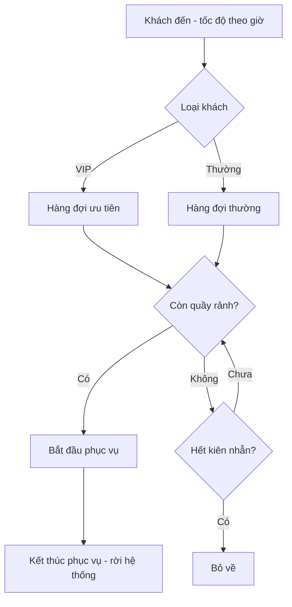

# Hướng dẫn làm Tuần 1 (cho cả 3 thành viên)

> **Nguyên tắc của tuần 1: chưa viết code mô phỏng.** Tuần này chỉ làm ba việc: có dữ liệu thật, có bảng tính Excel cho công thức hàng đợi, và có bản đặc tả mô hình rõ ràng. Code SimPy chỉ bắt đầu ở Tuần 2, sau khi đã qua "cổng kiểm soát" ở cuối tài liệu này.
>
> Đọc cùng `README.md` (kế hoạch tổng thể). Tài liệu này là phần chi tiết hóa riêng cho Tuần 1.

---

## Mục lục

1. [Mục tiêu và sản phẩm cuối tuần](#1-mục-tiêu-và-sản-phẩm-cuối-tuần)
2. [Phân công tổng quan và khối lượng](#2-phân-công-tổng-quan-và-khối-lượng)
3. [Lịch từng ngày](#3-lịch-từng-ngày)
4. [Thành viên A: Dữ liệu](#4-thành-viên-a-dữ-liệu)
5. [Thành viên B: Toán và Excel](#5-thành-viên-b-toán-và-excel)
6. [Thành viên C: Đặc tả mô hình và chuẩn bị khảo sát](#6-thành-viên-c-đặc-tả-mô-hình-và-chuẩn-bị-khảo-sát)
7. [Việc chung cả nhóm](#7-việc-chung-cả-nhóm)
8. [Kiểm tra chéo](#8-kiểm-tra-chéo)
9. [Cổng kiểm soát cuối Tuần 1](#9-cổng-kiểm-soát-cuối-tuần-1)
10. [Nếu bị kẹt](#10-nếu-bị-kẹt)
11. [Phụ lục: mẫu biểu](#11-phụ-lục-mẫu-biểu)

---

## 1. Mục tiêu và sản phẩm cuối tuần

### 1.1 Mục tiêu

1. Có **dữ liệu thật đã làm sạch** (từ bộ Anonymous Bank, và nếu xin được thì thêm dữ liệu tại chỗ).
2. Có **thống kê mô tả theo khung giờ**: số khách, tốc độ đến, thời gian phục vụ, tỉ lệ bỏ về.
3. Có **bảng Excel** tính được các chỉ số M/M/c (Erlang C) và số quầy tối thiểu từ λ, E[S] cho trước, đã kiểm tra bằng ví dụ tính tay.
4. Có **bản đặc tả mô hình**: sơ đồ luồng, tham số, giả định, chỉ số đo, danh sách thí nghiệm.
5. Cả nhóm hiểu cùng một định nghĩa SLA, cùng đơn vị thời gian, cùng định dạng dữ liệu.

### 1.2 Sản phẩm bàn giao cuối Tuần 1

| # | Sản phẩm | Người chịu trách nhiệm | File gợi ý |
|---|---|---|---|
| 1 | Dữ liệu thô và dữ liệu sạch, kèm mô tả nguồn | A | `data/raw/`, `data/clean/`, `docs/mo_ta_du_lieu.md` |
| 2 | Bảng thống kê mô tả theo khung giờ | A | `docs/thong_ke_mo_ta.xlsx` |
| 3 | Bảng tham số bàn giao cho B và C | A | `docs/bang_tham_so.xlsx` (xem 4.6) |
| 4 | Bảng Excel Erlang C đã kiểm tra | B | `excel/erlang.xlsx` |
| 5 | Ghi chú chứng minh và giải thích công thức | B | `docs/cong_thuc.md` |
| 6 | Bản đặc tả mô hình (có sơ đồ luồng) | C | `docs/dac_ta_mo_hinh.md` |
| 7 | Kế hoạch khảo sát tại chỗ (giấy phép, biểu mẫu, lịch) | C (cùng A) | `docs/ke_hoach_khao_sat.md` |
| 8 | Báo cáo tuần 1 (1 trang) | Cả nhóm | `docs/bao_cao_tuan_1.md` |

### 1.3 Cấu trúc thư mục dùng chung (tạo ngay Ngày 1)

```
queue_project/
├── data/
│   ├── raw/          # dữ liệu gốc, KHÔNG sửa tay
│   └── clean/        # dữ liệu đã làm sạch
├── docs/             # tài liệu, đặc tả, báo cáo
├── excel/            # bảng tính
├── common.py ...     # code (Tuần 2 mới đụng tới)
└── README.md
```

Quy ước đặt tên: chữ thường, không dấu, gạch dưới (`bang_tham_so.xlsx`). Dùng Git hoặc thư mục chung (Google Drive) và ghi ngày vào tên khi có phiên bản mới (`erlang_v2.xlsx`).

---

## 2. Phân công tổng quan và khối lượng

Mỗi người khoảng **14–16 giờ** trong tuần (khoảng 2 giờ mỗi ngày).

| | A: Dữ liệu | B: Toán và Excel | C: Đặc tả và khảo sát |
|---|---|---|---|
| Trọng tâm | Có dữ liệu sạch, thống kê mô tả | Bảng Excel đúng, ví dụ tính tay | Đặc tả mô hình, kế hoạch khảo sát |
| Giờ ước tính | 15 | 14 | 15 |
| Phụ thuộc vào | C (biểu mẫu khảo sát) | A (tham số thật, từ Ngày 5) | A (định dạng dữ liệu) |
| Giao cho | B, C (bảng tham số) | A, C (bảng Excel) | A, B (đặc tả) |

Ba việc **thật sự song song** trong 4 ngày đầu, chỉ cần thống nhất định dạng ở Ngày 1. Điều này giúp không ai phải chờ ai.

---

## 3. Lịch từng ngày

| Ngày | A | B | C | Chung |
|---|---|---|---|---|
| **1** | Tải dữ liệu Anonymous Bank, đọc tài liệu mô tả, gửi thông báo cho giáo sư phụ trách | Đọc mục 7 của `README.md`, dựng khung Excel (sheet Input) | Soạn giấy xin phép khảo sát, biểu mẫu ghi dữ liệu | Họp mở đầu 45 phút (7.1), tạo thư mục, thống nhất định nghĩa |
| **2** | Đọc cấu trúc file, chọn khung lọc, bắt đầu làm sạch | Cài công thức Erlang C trong Excel | Vẽ sơ đồ luồng khách, lập bảng tham số và giả định | Họp nhanh 15 phút |
| **3** | Làm sạch xong, tính số khách theo (ngày, giờ) | Kiểm tra bảng bằng ví dụ tính tay (c = 5 và c = 6) | Viết đặc tả: thực thể, sự kiện, chỉ số đo | Họp nhanh 15 phút |
| **4** | Thống kê mô tả theo khung giờ, kiểm định Poisson | Thêm bảng tra c theo SLA, bảng theo nhiều λ | Hoàn thiện đặc tả, liệt kê thí nghiệm, gửi A và B đọc | Họp nhanh 15 phút |
| **5** | Ước lượng E[S], cv, tỉ lệ bỏ về, hoàn thành **bảng tham số** | Dùng tham số thật của A điền sơ bộ bảng quyết định | Chuẩn bị khảo sát tại chỗ (liên hệ, lịch), đọc kỹ code hiện có | Họp nhanh 15 phút |
| **6** | Kiểm tra chéo công thức của B | Kiểm tra chéo đặc tả của C | Kiểm tra chéo bảng tham số của A | Họp kiểm tra chéo 60 phút |
| **7** | Sửa theo góp ý, hoàn thiện tài liệu | Sửa theo góp ý, hoàn thiện tài liệu | Sửa theo góp ý, hoàn thiện tài liệu | Họp tổng kết 60 phút, soạn báo cáo tuần 1, kiểm tra cổng (mục 9) |

---

## 4. Thành viên A: Dữ liệu

**Mục tiêu:** có dữ liệu sạch đúng định dạng và bảng tham số theo khung giờ để B và C dùng.

### 4.1 Ngày 1–2: lấy dữ liệu

**Việc 1. Dữ liệu Anonymous Bank.**

1. Vào trang dữ liệu của Technion SEE Center: `https://see-center.iem.technion.ac.il/databases/AnonymousBank/`. Tải tài liệu mô tả (`AnonymousBank.pdf`) và các file dữ liệu theo tháng.
2. **Đọc tài liệu mô tả trước khi mở dữ liệu.** Ghi lại: tên và ý nghĩa từng cột, đơn vị thời gian (thường là giây, phải kiểm tra), các loại kết quả của cuộc gọi (được phục vụ, bỏ về, bản ghi ảo cần loại), múi giờ, ngày làm việc trong tuần.
3. **Gửi thông báo sử dụng** cho giáo sư Avi Mandelbaum (email có trên trang dữ liệu), dùng mẫu ở [11.1](#111-mẫu-email-thông-báo-sử-dụng-dữ-liệu). Dữ liệu được dùng tự do nhưng yêu cầu thông báo và ghi nguồn. Lưu lại email đã gửi.
4. **Chỉ tải 1–2 tháng trước** để thử quy trình (mỗi tháng khoảng 20.000–30.000 cuộc gọi). Chưa cần cả 12 tháng.

**Việc 2. Lưu bản gốc.** Chép file gốc vào `data/raw/` và **không bao giờ sửa**. Mọi thao tác làm sạch ghi ra `data/clean/`.

**Việc 3. Viết `docs/mo_ta_du_lieu.md`** gồm: nguồn, ngày tải, tên file, số dòng, ý nghĩa cột, đơn vị, các quy tắc làm sạch dự định áp dụng.

### 4.2 Ngày 2–3: làm sạch và quy về định dạng chuẩn của dự án

Mục tiêu là bảng có đúng các cột sau (đây là định dạng mà code Tuần 2 sẽ đọc):

| Cột | Ý nghĩa | Kiểu |
|---|---|---|
| `day` | Số thứ tự ngày (0, 1, 2, ...) | số nguyên |
| `t` | Phút kể từ giờ mở cửa lúc khách vào hàng | số thực |
| `hour` | Khung giờ (0 = giờ đầu tiên) | số nguyên |
| `cls` | Loại dịch vụ (0 hoặc 1), trống nếu không có | số hoặc trống |
| `vip` | 1 nếu khách ưu tiên, 0 nếu thường | 0/1 |
| `wait` | Thời gian chờ (phút) | số thực |
| `served` | 1 nếu được phục vụ, 0 nếu bỏ về | 0/1 |
| `svc` | Thời gian phục vụ (phút), trống nếu bỏ về | số thực |

**Quy tắc làm sạch cần ghi lại (và áp dụng đồng nhất):**

- Loại bản ghi ảo, bản ghi thiếu thời gian, thời gian âm.
- Đổi đơn vị sang **phút** (nếu dữ liệu gốc là giây thì chia 60).
- Chọn **một loại dịch vụ** (hoặc lọc những loại tương đồng) để mô hình thống nhất. Ghi rõ lý do chọn.
- Chọn **khung ngày giờ làm việc** gần với quầy ngân hàng (ví dụ ngày làm việc, 8h–17h). Lưu ý tuần làm việc của dữ liệu gốc khác Việt Nam.
- Xử lý ngoại lai (thời gian phục vụ bằng 0 hoặc rất dài): quyết định giữ hay loại, ghi số lượng và lý do.
- Nếu dữ liệu không có cột VIP, `vip = 0`. Nếu không có loại giao dịch, `cls` để trống. Đừng bịa cột.

**Kiểm tra sau làm sạch:** `wait ≥ 0`, `svc > 0` với khách được phục vụ, số khách theo giờ không bất thường, tổng số dòng trước và sau làm sạch được ghi lại.

Bạn **được dùng Python/pandas** để làm sạch dữ liệu (đây không phải code mô phỏng). Lưu script làm sạch thành `data/lam_sach.py` để người khác chạy lại được.

### 4.3 Ngày 3–4: thống kê mô tả theo khung giờ

Với mỗi khung giờ `h` tính:

| Chỉ số | Cách tính |
|---|---|
| Số khách mỗi ngày | Đếm theo (ngày, giờ) |
| Số khách trung bình `N̄_h` | Trung bình theo các ngày |
| Tốc độ đến `λ_h` (khách/phút) | `N̄_h / 60` |
| Khoảng tin cậy 95% của `λ_h` | `λ_h ± 1,96 · √(N̄_h / n_ngày) / 60` |
| Chỉ số phân tán `D_h` | `Σ(N_i − N̄_h)² / N̄_h` |
| P-value Poisson | `CHISQ.DIST.RT(D_h, n_ngày − 1)` trong Excel |
| Tỉ lệ bỏ về | Số khách bỏ về / tổng khách đến |

**Kiểm định cần làm:**

1. **Poisson trong từng khung giờ:** nếu p-value lớn (ví dụ > 0,05) thì chưa bác bỏ Poisson.
2. **Tốc độ đến đều qua các giờ không:** tính `χ² = Σ(T_h − T̄)² / T̄` với `T_h` là tổng số khách của khung giờ h qua mọi ngày, bậc tự do = số giờ − 1. Thường bị bác bỏ rất mạnh, nghĩa là phải tính riêng từng khung giờ.

Xuất kết quả vào `docs/thong_ke_mo_ta.xlsx` và vẽ một biểu đồ cột "số khách theo giờ" có thanh sai số.

### 4.4 Ngày 4–5: thời gian phục vụ và bỏ về

**Thời gian phục vụ** (chỉ khách được phục vụ):

- Tính `E[S]` (trung bình), độ lệch chuẩn, `cv = std / mean`, `cs² = cv²`.
- Vẽ histogram. Fit thử exponential, lognormal, gamma, Weibull (cố định vị trí 0), so sánh AIC, KS, Q-Q plot. Ghi lại phân phối nào khớp nhất.
- Nếu có hai loại dịch vụ khác biệt rõ (một nhóm nhanh, một nhóm lâu), hãy tách và tính riêng. Thường dữ liệu gộp sẽ không khớp phân phối đơn nào, còn tách theo loại thì khớp.
- Nhớ rằng p-value của KS với tham số ước lượng từ mẫu là hơi lạc quan; ghi chú điều này.

**Bỏ về:**

- Ước lượng tốc độ bỏ về (phân phối mũ, dữ liệu bị kiểm duyệt): `θ̂ = (số khách bỏ về) / (tổng thời gian chờ của tất cả khách)`.
- Khoảng tin cậy gần đúng: `θ̂ · (1 ± 1,96 / √số_khách_bỏ_về)`. Kiên nhẫn trung bình là `1/θ̂`.
- Nếu dữ liệu không có khách bỏ về, ghi rõ và đặt `θ = 0`.

### 4.5 Khảo sát tại chỗ (làm cùng C, nếu xin được phép)

- A phụ trách xử lý dữ liệu sau khảo sát. Dùng đúng định dạng ở 4.2.
- Với tuần 1, mục tiêu khảo sát chỉ là **chạy thử (pilot) 1 buổi** để kiểm tra biểu mẫu có dùng được không. Chi tiết ở phần C (6.5).

### 4.6 Ngày 5: bảng tham số bàn giao

Tạo `docs/bang_tham_so.xlsx` gồm hai sheet.

**Sheet `theo_gio`:**

| Khung giờ | N̄_h (khách/ngày) | λ_h (khách/phút) | CI95 của λ_h | p-value Poisson |
|---|---|---|---|---|

**Sheet `chung`:**

| Tham số | Giá trị | CI95 | Ghi chú |
|---|---|---|---|
| E[S] (phút) | | | |
| cv | | | |
| cs² | | | |
| Phân phối khớp nhất | | | |
| Tỉ lệ loại giao dịch (nếu tách) | | | |
| θ (bỏ về) | | | |
| Tỉ lệ VIP (nếu có) | | | |

B và C dùng bảng này, nên cột "Ghi chú" phải ghi rõ cách tính và nguồn dữ liệu.

### 4.7 Tiêu chí hoàn thành của A

- [ ] Dữ liệu gốc nằm ở `data/raw/`, không bị sửa.
- [ ] Có script làm sạch chạy lại được và file sạch ở `data/clean/` đúng định dạng 4.2.
- [ ] Đã gửi email thông báo cho giáo sư phụ trách dữ liệu và lưu lại.
- [ ] `docs/mo_ta_du_lieu.md` đủ để người ngoài hiểu dữ liệu và cách làm sạch.
- [ ] Bảng thống kê mô tả theo giờ có kiểm định Poisson.
- [ ] `docs/bang_tham_so.xlsx` đã bàn giao cho B và C.

---

## 5. Thành viên B: Toán và Excel

**Mục tiêu:** có bảng Excel cho Erlang C chạy đúng, đã đối chiếu với ví dụ tính tay, và giải thích được từng công thức.

### 5.1 Ngày 1: đọc và chuẩn bị

- Đọc mục 7.1 và 8 của `README.md`.
- Tự suy ra lại (trên giấy) các công thức: `a = λ·E[S]`, `ρ = a/c`, `C(c, a)`, `Wq = C/(cμ − λ)`, `P(Wq ≤ t) = 1 − C·exp(−(cμ − λ)t)`. Hiểu từng công thức nói gì, đặc biệt vì sao điều kiện `c > a` là bắt buộc.
- Dựng sheet `Input` như 5.2.

### 5.2 Ngày 1–2: dựng Excel

**Sheet `Input`** (ô cố định, đặt tên ô cho dễ đọc):

| Ô | Nội dung | Công thức |
|---|---|---|
| B1 | λ (khách/phút) | nhập tay |
| B2 | E[S] (phút) | nhập tay |
| B3 | μ = 1/E[S] | `=1/B2` |
| B4 | a = λ·E[S] (Erlang) | `=B1*B2` |
| B5 | Ngưỡng chờ t (phút) | `5` |
| B6 | Mục tiêu P(chờ ≤ t) | `0.9` |

**Sheet `ErlangC`** (từ dòng 10 trở xuống, dòng 9 là tiêu đề):

| Cột | Nội dung | Công thức dòng 10 |
|---|---|---|
| A | Số quầy c | `=INT(Input!$B$4)+1` (dòng dưới: `=A10+1`) |
| B | ρ = a/c | `=Input!$B$4/A10` |
| C | Xác suất phải chờ C(c, a) | `=(POISSON.DIST(A10,Input!$B$4,FALSE)/(1-B10))/((POISSON.DIST(A10,Input!$B$4,FALSE)/(1-B10))+POISSON.DIST(A10-1,Input!$B$4,TRUE))` |
| D | Wq (phút) | `=C10/(A10*Input!$B$3-Input!$B$1)` |
| E | Lq | `=Input!$B$1*D10` |
| F | P(chờ ≤ t) | `=1-C10*EXP(-(A10*Input!$B$3-Input!$B$1)*Input!$B$5)` |
| G | Đạt mục tiêu? | `=IF(F10>=Input!$B$6,"ĐẠT","KHÔNG")` |

Kéo công thức xuống khoảng 15 dòng. Ô kết quả chính: **số quầy nhỏ nhất đạt** `=INDEX(A10:A24,MATCH("ĐẠT",G10:G24,0))`.

Ghi chú về công thức C: tử và mẫu của biểu thức Erlang C đều có thừa số `e^{-a}`, nên có thể dùng hàm Poisson của Excel để tránh tính giai thừa lớn. `POISSON.DIST(c, a, FALSE)` là `e^{-a}·aᶜ/c!` và `POISSON.DIST(c−1, a, TRUE)` là `e^{-a}·Σ_{k<c} aᵏ/k!`. Nếu Excel của bạn cũ, dùng `POISSON` thay cho `POISSON.DIST`. Google Sheets cũng có `POISSON.DIST`.

### 5.3 Ngày 3: kiểm tra bằng ví dụ tính tay

Nhập `λ = 1,5`, `E[S] = 3`, `t = 5`. Bảng phải cho **đúng** các giá trị sau (sai số làm tròn ở chữ số thập phân thứ 3):

| c | ρ | C(c, a) | Wq (phút) | P(chờ ≤ 5) | Kết luận |
|---|---|---|---|---|---|
| 5 | 0,900 | 0,7625 | 4,58 | 0,669 | KHÔNG |
| 6 | 0,750 | 0,4217 | 0,84 | 0,965 | ĐẠT |

Số quầy nhỏ nhất phải ra **6**. Nếu không khớp: kiểm tra đơn vị (phút), kiểm tra B3 có bằng `1/B2` không, kiểm tra dấu ngoặc trong công thức C.

**Tính tay lại** dòng c = 5 và c = 6 trên giấy (các bước ở mục 8.2 của `README.md`), chụp ảnh đưa vào `docs/cong_thuc.md`. Nhờ một bạn khác trong nhóm tính độc lập để đối chiếu.

### 5.4 Ngày 4: mở rộng bảng

1. **Sheet `Tra_c`:** bảng tra số quầy tối thiểu theo λ (từ 0,5 đến 3,0 bước 0,25) và E[S] (2, 3, 4, 5 phút). Mỗi ô tính c nhỏ nhất đạt SLA (có thể dùng bảng phụ hoặc công thức mảng; nếu khó, chỉ cần làm cho một E[S] cố định).
2. **Sheet `Allen_Cunneen`:** thêm ô `cs²` và dòng `Wq_MGc = (1 + cs²)/2 · Wq`. Chỉ dùng để ước lượng thời gian chờ trung bình khi phục vụ không phải phân phối mũ.
3. **Sheet `Quy_tac_can_bac_hai` (tùy chọn):** tính `c ≈ a + β√a` để so sánh nhanh với kết quả Erlang C.

### 5.5 Ngày 4–5: Erlang-A cho trường hợp có bỏ về (mục nâng cao)

Làm nếu còn thời gian. Chuỗi sinh–tử có thể cài bằng một cột:

| Cột | Nội dung | Công thức |
|---|---|---|
| A | n = 0, 1, 2, ..., c + 100 | |
| B | Tốc độ chết `d_n` | `=MIN(A11,c)*μ + MAX(A11-c,0)*θ` |
| C | π chưa chuẩn hóa | dòng đầu `=1`, các dòng sau `=C10*λ/B11` |
| D | π chuẩn hóa | `=C11/SUM(C:C)` (cột C cố định vùng) |

Từ đó: `Lq = SUMPRODUCT(max(n−c,0), π)`, `Wq = Lq/λ`, tỉ lệ bỏ về `= θ·Lq/λ`. Phần `SL(t)` chính xác của Erlang-A cần ma trận mũ, **để Tuần 2** (Python đã có sẵn hàm `erlang_a` trong `b_theory.py` để đối chiếu).

### 5.6 Ngày 5: điền thử bảng quyết định bằng tham số thật

Khi A bàn giao `bang_tham_so.xlsx`, tạo sheet `Quyet_dinh` theo mẫu ở mục 8.1 của `README.md`:

| Khung giờ | λ | E[S] | cs² | a | c theo Erlang C | ρ | SL dự kiến |
|---|---|---|---|---|---|---|---|

Mỗi dòng dùng `λ_h` của giờ đó, `E[S]` và `cs²` chung (hoặc theo loại nếu có). Đây là bản sơ bộ, Tuần 2 sẽ hoàn thiện (thêm Erlang-A, đối chiếu với mô phỏng).

### 5.7 Viết `docs/cong_thuc.md`

Ngắn gọn nhưng đầy đủ: ký hiệu, công thức, điều kiện áp dụng, ví dụ tính tay có hình chụp, giới hạn của mô hình (Poisson, phục vụ mũ, hệ dừng). B phải trả lời được "vì sao" cho từng công thức.

### 5.8 Tiêu chí hoàn thành của B

- [ ] Excel cho kết quả khớp bảng ở 5.3 (c = 5 và c = 6).
- [ ] Ví dụ tính tay được hai người độc lập đối chiếu.
- [ ] Có bảng tra c theo λ và E[S].
- [ ] Có sheet `Quyet_dinh` điền sơ bộ bằng tham số thật của A.
- [ ] `docs/cong_thuc.md` hoàn chỉnh.

---

## 6. Thành viên C: Đặc tả mô hình và chuẩn bị khảo sát

**Mục tiêu:** viết được "hợp đồng" cho mô phỏng (nó mô phỏng cái gì, tham số nào, đo gì) và lo phần thực địa. Đặc tả tốt thì Tuần 2 viết code rất nhanh.

### 6.1 Ngày 1: giấy phép và biểu mẫu khảo sát

- Soạn **giấy xin phép khảo sát** (mẫu ở [11.2](#112-mẫu-thư-xin-phép-khảo-sát)), nhờ giảng viên ký giấy giới thiệu.
- Liệt kê 3–4 địa điểm có thể xin: chi nhánh ngân hàng, bộ phận một cửa, phòng đào tạo, phòng công tác sinh viên, căng tin. Ưu tiên nơi **có máy lấy số** vì có thể xin log đã ẩn danh.
- Chuẩn bị **biểu mẫu ghi** ([11.3](#113-biểu-mẫu-ghi-dữ-liệu-tại-chỗ)).

### 6.2 Ngày 2: sơ đồ luồng khách và tham số

Vẽ sơ đồ luồng (draw.io, giấy, hoặc Mermaid như dưới đây). Đây là sơ đồ gợi ý để chỉnh lại theo hệ thống của nhóm:



Cùng lúc lập **bảng tham số** (xem 6.3).

### 6.3 Ngày 2–4: viết `docs/dac_ta_mo_hinh.md`

Tài liệu gồm các mục sau (mỗi mục viết ngắn, chính xác):

**1. Mục đích mô hình.** Trả lời câu hỏi nào? (Số quầy tối thiểu mỗi giờ để đạt SLA.)

**2. Định nghĩa SLA.** `SL(t) = P(được phục vụ và chờ ≤ t)` trên mọi khách đến, khách bỏ về tính là không đạt. Ngưỡng: 5 phút cho khách thường, 2 phút cho khách ưu tiên (nếu có), mục tiêu 90%.

**3. Thực thể và trạng thái.**

| Thực thể | Thuộc tính | Khi nào sinh ra |
|---|---|---|
| Khách | giờ đến, loại dịch vụ, ưu tiên, thời gian phục vụ, kiên nhẫn | Lúc đến |
| Quầy | đang phục vụ hay rảnh, đang mở hay đóng theo lịch | Cố định |
| Hàng đợi | danh sách khách đang chờ, có ưu tiên | Cố định |

**4. Sự kiện.** Khách đến, vào hàng, bắt đầu phục vụ, kết thúc phục vụ, bỏ về, đổi lịch quầy (đầu mỗi giờ).

**5. Tham số đầu vào** (điền giá trị khi A bàn giao):

| Tham số | Ký hiệu | Nguồn |
|---|---|---|
| Tốc độ đến theo giờ | λ_h | A |
| Phân phối thời gian phục vụ và tham số | | A |
| Tỉ lệ loại giao dịch | p | A |
| Tốc độ bỏ về | θ | A |
| Tỉ lệ VIP | p_vip | A |
| Lịch số quầy | c_h | Biến quyết định |

**6. Giả định** (ghi đủ, xem mục 2.3 của `README.md`) và lý do chấp nhận từng giả định.

**7. Điều kiện đầu và điều kiện dừng.** Hệ thống trống lúc mở cửa. Nhân viên rời quầy khi hết lịch nhưng chỉ sau khi xong khách đang phục vụ. Mô phỏng dừng khi mọi khách đã xử lý xong.

**8. Chỉ số đo.** `SL` toàn ngày và theo từng giờ, `SL` của khách ưu tiên, thời gian chờ trung bình, độ dài hàng đợi, tỉ lệ bỏ về, hiệu suất sử dụng quầy, tổng quầy-giờ.

**9. Danh sách thí nghiệm** (sẽ làm ở Tuần 2 và 3):

| # | Thí nghiệm | Mục đích |
|---|---|---|
| T1 | M/M/c hệ dừng | Kiểm chứng tầng 1 so với Erlang C |
| T2 | Thêm bỏ về | Kiểm chứng tầng 2 so với Erlang-A |
| T3 | Phục vụ lognormal với cv khác nhau | Kiểm chứng tầng 3 so với Allen–Cunneen |
| T4 | Hàng chung và hàng riêng | Minh họa hiệu ứng gộp hàng đợi |
| T5 | Tối ưu lịch theo giờ | Kết quả chính |
| T6 | Độ nhạy theo nhu cầu | Đánh giá độ bền |

**10. Kế hoạch kiểm chứng.** Tiêu chí đạt cho từng tầng (sai lệch dưới 2% hoặc nằm trong khoảng tin cậy).

**11. Số lần lặp và seed.** Dự kiến 30 lần lặp khi kiểm chứng, 60 khi tối ưu, 300 khi đánh giá cuối; dùng seed cố định để lặp lại được.

### 6.4 Ngày 5: đọc code hiện có (chỉ đọc, chưa sửa)

Đọc `common.py` và `c_sim.py` để hiểu cách code hiện tại hiện thực đặc tả. Với mỗi mục trong đặc tả, ghi lại **hàm nào trong code đảm nhiệm** và những chỗ cần sửa khi dùng dữ liệu thật (xem mục 14 của `README.md`). Không cần sửa gì ở tuần này.

### 6.5 Khảo sát tại chỗ (cùng A)

1. Gửi thư xin phép tại 1–2 nơi ngay từ Ngày 1–2 (phản hồi có thể mất vài ngày).
2. Nếu được đồng ý, **chạy thử 1 buổi 1–2 giờ** (Ngày 5–7) để kiểm tra biểu mẫu, phân vai, đồng hồ đồng bộ. Mục tiêu là kiểm tra quy trình, không cần số liệu hoàn chỉnh.
3. Nếu chưa được phép, **không chờ**. Tuần 1 đã đủ việc với dữ liệu Anonymous Bank. Ghi vào báo cáo tuần là khảo sát thực địa chuyển sang Tuần 2 hoặc bỏ nếu bị từ chối.
4. Quy trình, phân vai và cỡ mẫu xem mục 5.2 và 5.3 của `README.md`.

### 6.6 Viết `docs/ke_hoach_khao_sat.md`

Gồm: địa điểm đã liên hệ và trạng thái, ngày giờ dự kiến, ai làm gì, biểu mẫu, cam kết bảo mật, kế hoạch dự phòng nếu bị từ chối.

### 6.7 Tiêu chí hoàn thành của C

- [ ] Sơ đồ luồng được cả nhóm đồng ý.
- [ ] `docs/dac_ta_mo_hinh.md` đủ 11 mục, A và B đã đọc và không còn câu hỏi.
- [ ] Đã gửi ít nhất 2 thư xin khảo sát (hoặc có lý do rõ ràng nếu không).
- [ ] Có biểu mẫu ghi dữ liệu và đã chạy thử (nếu được phép).
- [ ] Đã đọc code hiện có và ghi bảng "đặc tả ↔ hàm trong code".

---

## 7. Việc chung cả nhóm

### 7.1 Họp mở đầu (Ngày 1, 45 phút)

Nội dung bắt buộc:

1. Thống nhất **định nghĩa SLA** (mục 1.2 của `README.md`).
2. Thống nhất **đơn vị thời gian: phút** cho mọi thứ (λ là khách/phút, E[S] tính bằng phút).
3. Thống nhất **định dạng dữ liệu** (bảng ở 4.2).
4. Thống nhất **cấu trúc thư mục** và cách lưu file (mục 1.3).
5. Chốt lịch họp nhanh mỗi ngày (15 phút, cùng giờ) và cách liên lạc.
6. Mỗi người nói điều mình lo nhất; ghi lại.

### 7.2 Họp nhanh hằng ngày (15 phút, Ngày 2–5)

Mỗi người trả lời ba câu: hôm qua làm được gì, hôm nay làm gì, đang kẹt ở đâu. Ghi lại vào `docs/nhat_ky.md`.

### 7.3 Họp kiểm tra chéo (Ngày 6, 60 phút) và tổng kết (Ngày 7, 60 phút)

Xem mục 8 và 9.

### 7.4 Báo cáo tuần 1 (1 trang, `docs/bao_cao_tuan_1.md`)

Nội dung: đã làm được gì (theo ba người), kết quả chính (vài con số quan trọng: λ_h, E[S], cv, c ví dụ), vấn đề gặp phải và cách xử lý, kế hoạch Tuần 2.

---

## 8. Kiểm tra chéo

Mỗi người kiểm tra sản phẩm của một người khác, theo vòng:

| Người kiểm tra | Kiểm tra sản phẩm của | Cần xem gì |
|---|---|---|
| A | B | Công thức trong Excel có khớp ví dụ tính tay không? Đơn vị có nhất quán không? |
| B | C | Đặc tả có đủ để viết code không? Công thức SLA và các giả định có mâu thuẫn lý thuyết không? |
| C | A | Dữ liệu sạch có đúng định dạng 4.2 không? Bảng tham số có đủ và có chú thích rõ không? |

Người kiểm tra ghi nhận xét vào bảng:

| Mục | Phát hiện | Mức độ (nhẹ/trung bình/nặng) | Đã sửa? |
|---|---|---|---|

Lỗi mức "nặng" phải sửa trước khi qua cổng kiểm soát.

---

## 9. Cổng kiểm soát cuối Tuần 1

Chỉ được bắt đầu Tuần 2 (viết code mô phỏng) khi **tất cả** các mục sau được đánh dấu.

**Dữ liệu**
- [ ] Dữ liệu sạch đúng định dạng, có script làm sạch chạy lại được.
- [ ] Đã gửi email thông báo cho nơi cung cấp dữ liệu và ghi nguồn trong tài liệu.
- [ ] Bảng tham số theo khung giờ đã bàn giao, có khoảng tin cậy.

**Toán**
- [ ] Excel cho kết quả đúng với ví dụ tính tay (c = 5 và c = 6).
- [ ] Ví dụ tính tay được hai người độc lập xác nhận.
- [ ] Sheet `Quyet_dinh` đã điền sơ bộ bằng tham số thật.

**Đặc tả**
- [ ] Đặc tả mô hình đủ 11 mục và cả nhóm đã đọc.
- [ ] Sơ đồ luồng, danh sách thí nghiệm đã chốt.
- [ ] Bảng "đặc tả ↔ hàm trong code" đã có.

**Quản lý**
- [ ] Đã kiểm tra chéo và sửa mọi lỗi mức nặng.
- [ ] Báo cáo tuần 1 đã viết.
- [ ] Kế hoạch Tuần 2 đã chia việc.

Nếu còn mục chưa xong, ghi rõ lý do, ai sửa, hạn bao giờ; không bắt đầu code mô phỏng khi **bảng tham số** hoặc **Excel Erlang C** chưa đạt.

---

## 10. Nếu bị kẹt

| Tình huống | Cách xử lý |
|---|---|
| Không hiểu cột nào trong dữ liệu Anonymous Bank | Đọc lại tài liệu mô tả, so với bài báo mô tả bộ dữ liệu (Brown và cộng sự, 2005); ghi câu hỏi và hỏi giảng viên |
| Đơn vị thời gian nghi ngờ | Kiểm tra bằng sự hợp lý: thời gian phục vụ trung bình vài phút là bình thường; nếu ra vài trăm thì có thể đang là giây |
| Dữ liệu quá lớn, mở Excel bị treo | Lọc trước bằng Python, chỉ giữ 1–2 tháng và các cột cần thiết |
| Excel không khớp ví dụ tính tay | Kiểm tra theo thứ tự: đơn vị, `μ = 1/E[S]`, ngoặc trong công thức C, chỉ số `c` và `c−1` trong hàm Poisson |
| KS bác bỏ mọi phân phối | Bình thường với dữ liệu gộp; thử tách theo loại dịch vụ, dựa vào AIC và Q-Q plot, ghi nhận xét |
| Không xin được khảo sát tại chỗ | Không chờ; chuyển sang chỉ dùng Anonymous Bank và ghi rõ hạn chế |
| Không đồng ý định nghĩa SLA | Dùng định nghĩa ở mục 1.2 của `README.md` trừ khi cả nhóm và giảng viên đồng ý đổi |
| Quá tải việc | Ưu tiên theo thứ tự: dữ liệu sạch, Excel đúng, đặc tả; bỏ mục "nâng cao" (5.5, 5.4 mục 3) |

---

## 11. Phụ lục: mẫu biểu

### 11.1 Mẫu email thông báo sử dụng dữ liệu

> **Tiêu đề:** Notification of use of the Anonymous Bank call-center data (student project)
>
> Dear Professor Mandelbaum,
>
> We are a team of three undergraduate students at [Tên trường], [Tên nước]. For our course project on queueing theory and discrete-event simulation, we would like to use the "Anonymous Bank" call-center data made available by the Technion SEE Center. In accordance with the usage note on the data page, we are writing to let you know about this use. We will acknowledge the data source in our report and presentation.
>
> Our project estimates arrival and service-time distributions from the data, applies Erlang-type models, and uses simulation to determine staffing levels that meet a service-level target. If you have any recommendations on the correct handling of the data, we would be grateful to hear them.
>
> Thank you very much for making the data available.
>
> Sincerely,
> [Họ tên], [Mã sinh viên], [Email], [Trường/Khoa], [Giảng viên hướng dẫn]

(Địa chỉ email lấy từ trang dữ liệu chính thức, không tự suy đoán.)

### 11.2 Mẫu thư xin phép khảo sát

> **Kính gửi:** Ban lãnh đạo [Tên đơn vị]
>
> Nhóm sinh viên chúng em gồm [số người] bạn thuộc [Khoa/Lớp] trường [Tên trường], đang thực hiện đề tài môn [Tên môn] về **lý thuyết hàng đợi và mô phỏng**, nhằm xác định số quầy phục vụ phù hợp với một mức cam kết dịch vụ.
>
> Chúng em kính mong được phép quan sát và ghi nhận **thời điểm khách đến, bắt đầu và kết thúc được phục vụ** tại [địa điểm] trong [số] buổi, mỗi buổi khoảng [1–2 giờ], vào khung giờ [..]. Nhóm **không ghi tên, giấy tờ hay bất kỳ thông tin cá nhân nào** của khách, không quay phim hay chụp ảnh, và không làm ảnh hưởng đến hoạt động của đơn vị. Nếu đơn vị có sẵn dữ liệu từ máy lấy số thứ tự đã được ẩn danh, chúng em xin phép được sử dụng thay cho quan sát trực tiếp.
>
> Dữ liệu chỉ phục vụ học tập, kết quả tổng hợp sẽ được gửi lại cho đơn vị nếu quý đơn vị mong muốn.
>
> Trân trọng cảm ơn.
>
> [Họ tên, mã sinh viên, số điện thoại]
> Giảng viên hướng dẫn xác nhận: [Họ tên, chữ ký]

### 11.3 Biểu mẫu ghi dữ liệu tại chỗ

Mỗi dòng là một khách. Giờ ghi theo đồng hồ chung (giờ:phút:giây).

| STT | Giờ vào hàng | Giờ bắt đầu phục vụ | Giờ kết thúc | Quầy số | Loại giao dịch (N/P) | VIP (0/1) | Bỏ về (0/1) | Giờ bỏ về |
|---|---|---|---|---|---|---|---|---|

Phân vai mỗi buổi (3 người):
- Người 1: ghi giờ vào hàng và khách bỏ về.
- Người 2: ghi giờ bắt đầu phục vụ ở các quầy.
- Người 3: ghi giờ kết thúc phục vụ và phân loại giao dịch.

Ghi thêm ở đầu mỗi buổi: ngày, giờ bắt đầu, địa điểm, **số quầy đang mở** (cập nhật mỗi khi thay đổi), thời tiết hoặc sự kiện bất thường.

Sau buổi: nhập vào bảng tính trong ngày, đối chiếu ba bản ghi, đưa về định dạng ở 4.2.

### 11.4 Mẫu bảng nhật ký nhóm (`docs/nhat_ky.md`)

```
## Ngày [..]
- A: đã làm [..]; sẽ làm [..]; đang kẹt [..]
- B: đã làm [..]; sẽ làm [..]; đang kẹt [..]
- C: đã làm [..]; sẽ làm [..]; đang kẹt [..]
- Quyết định chung: [..]
```

### 11.5 Mẫu báo cáo tuần 1 (1 trang)

```
# Báo cáo Tuần 1
1. Mục tiêu tuần: [..]
2. Kết quả theo người: A [..]; B [..]; C [..]
3. Số liệu chính: λ theo giờ [..]; E[S] [..]; cv [..]; c ví dụ [..]
4. Vấn đề và cách xử lý: [..]
5. Cổng kiểm soát: đạt / chưa đạt (mục nào, vì sao)
6. Kế hoạch Tuần 2: [..]
```
