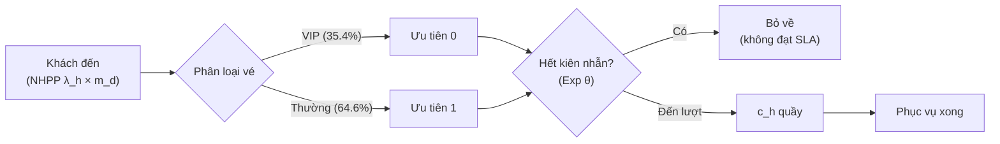

# BÁO CÁO TỔNG KẾT DỰ ÁN
# MÔ PHỎNG HÀNG ĐỢI VÀ XÁC ĐỊNH SỐ QUẦY PHỤC VỤ TỐI ƯU CHO CHI NHÁNH NGÂN HÀNG

**Học phần:** Mô phỏng Hệ thống Dịch vụ / Khoa học Dịch vụ  
**Nhóm sinh viên thực hiện:**
- **Thành viên A (Nguyễn Văn A):** Dữ liệu, ước lượng tham số, kiểm định phân phối, độ bất định, ngoài mẫu
- **Thành viên B (Trần Thị B):** Lý thuyết hàng đợi, bài toán ca làm việc (MILP), phân tích chi phí
- **Thành viên C (Lê Văn C):** Mô phỏng SimPy, kiểm chứng ba tầng, tối ưu hóa lịch quầy, phân tích độ nhạy

**Thời gian hoàn thành:** Tháng 10/2026  
**Phiên bản số liệu:** V5, đóng băng tại `results/final_v5/` ngày 2026-10-30 (`python main.py --stage all --reps-scale 1.0`, 15.1 phút). Mọi số của V4 giữ nguyên; V5 thêm tối ưu theo giờ công (M6), chọn lịch theo xác suất đạt SLA ngày (M7), mở thêm quầy theo hàng chờ (M8) và bốn phân tích thống kê bổ sung (S12–S15). Bảng số chi tiết và nguồn từng con số: [`tong_hop.md`](../tong_hop.md).

---

## MỤC LỤC

1. [Bài toán, mục tiêu và cam kết dịch vụ (SLA)](#1-bài-toán-mục-tiêu-và-cam-kết-dịch-vụ-sla)
2. [Mô tả hệ thống, giả định và phạm vi](#2-mô-tả-hệ-thống-giả-định-và-phạm-vi)
3. [Dữ liệu thực tế](#3-dữ-liệu-thực-tế)
4. [Ước lượng tham số, kiểm định, độ bất định và ngoài mẫu](#4-ước-lượng-tham-số-kiểm-định-độ-bất-định-và-ngoài-mẫu)
5. [Cơ sở lý thuyết hàng đợi](#5-cơ-sở-lý-thuyết-hàng-đợi)
6. [Bảng quyết định giải tích, chi phí, ca làm việc và lịch bền vững](#6-bảng-quyết-định-giải-tích-chi-phí-ca-làm-việc-và-lịch-bền-vững)
7. [Mô hình mô phỏng SimPy](#7-mô-hình-mô-phỏng-simpy)
8. [Kiểm chứng mô hình](#8-kiểm-chứng-mô-hình)
9. [Tối ưu lịch quầy, so sánh chính sách và độ nhạy](#9-tối-ưu-lịch-quầy-so-sánh-chính-sách-và-độ-nhạy)
10. [Kết luận, khuyến nghị và hạn chế](#10-kết-luận-khuyến-nghị-và-hạn-chế)
11. [Tài liệu tham khảo và phụ lục](#11-tài-liệu-tham-khảo-và-phụ-lục)

---

## 1. BÀI TOÁN, MỤC TIÊU VÀ CAM KẾT DỊCH VỤ (SLA)

### 1.1 Bài toán
Mở ít quầy thì khách chờ lâu và bỏ về; mở nhiều quầy thì tốn chi phí và quầy rảnh. Câu hỏi: **số quầy tối thiểu theo từng khung giờ để đạt cam kết dịch vụ là bao nhiêu, và kết luận đó bền đến đâu?**

### 1.2 Cam kết dịch vụ
1. **SLA chính, tính trên mọi khách đến (VIP và thường):** $SL = P(\text{được phục vụ và } W_q \le 5\text{ phút}) \ge 90\%$. Đây là ràng buộc duy nhất khi chọn lịch, vì Erlang C, Erlang-A và SIPP không tách nhóm khách.
2. **Hai chỉ số giám sát (không ràng buộc):** $SL(5)$ riêng khách thường và $P(W_q \le 2\text{ phút})$ riêng khách VIP (khoảng 35% khách), báo cáo ở `sl_theo_nhom.csv` (V5.1). Riêng khách thường, Lịch 45 không đạt 90% ở 11h–12h; Lịch 48 đạt cả ba chỉ số ở mọi giờ.
3. **Khách bỏ về tính là không đạt.** Mẫu số là mọi khách đến:
   $$SL = \frac{\text{Số khách được phục vụ với } W_q \le 5}{\text{Tổng số khách đến}}$$
4. **Tiêu chí khả thi của lịch:** cận dưới CI95 của SL **ở mọi giờ** $\ge 0.90$.

---

## 2. MÔ TẢ HỆ THỐNG, GIẢ ĐỊNH VÀ PHẠM VI

### 2.1 Cấu trúc
Chi nhánh mở 8:00–17:00, chia 9 khung giờ ($h = 0 \dots 8$). Một hàng chờ chung (bốc số), hai mức ưu tiên (VIP trước, không ngắt), số quầy $c_h$ thay đổi theo giờ.



### 2.2 Giả định
1. **Dòng đến:** Poisson không thuần nhất, $\lambda_h$ hằng trong từng giờ; khoảng đến được rút lại khi vượt ranh giới giờ (sửa F2). Quy mô ngày dao động theo hệ số nhân $m_d \sim \text{Gamma}$ với $CV_{\text{ngày}} = 14.0\%$ (ước lượng trên train).
2. **Thời gian phục vụ:** lấy mẫu có hoàn lại từ 6.346 thời gian phục vụ thực tế của tập train ($E[S] = 2.9236$ phút, $cs^2 = 1.20$). Gamma ($cs^2 = 0.91$) chỉ dùng trong phân tích độ nhạy (M3).
3. **Kiên nhẫn:** phân phối mũ, $\theta = 0.1087$ phút$^{-1}$ (trung bình 9.2 phút).
4. **Biên thời gian:** mở cửa với hệ thống trống; sau 17:00 không nhận khách mới, hàng còn tồn được xả bằng **đúng số quầy của giờ cuối** (sửa F1).
5. Quầy đa năng, năng suất như nhau; nhân viên chỉ rời quầy sau khi phục vụ xong khách đang xử lý.

### 2.3 Phạm vi
- **Trong phạm vi:** nghiệp vụ cá nhân thông thường (`PS`), ngày làm việc tiêu chuẩn.
- **Ngoài phạm vi:** quầy chuyên biệt theo kỹ năng, chuyển hàng (jockeying), biến động theo thứ trong tuần, chi phí tiền tệ chi tiết.

---

## 3. DỮ LIỆU THỰC TẾ

### 3.1 Nguồn
Bộ dữ liệu **Anonymous Bank Call Center** (Technion SEE Center, Israel), tháng 9/1999. Đây là dữ liệu **tổng đài**, dùng phép tương đương: nhân viên trực = quầy, cuộc gọi = khách, cúp máy khi chờ = bỏ về.

### 3.2 Làm sạch (`data/lam_sach.py`)
1. Giữ nghiệp vụ `PS`, khung 8:00–17:00.
2. Giữ 14 ngày làm việc tiêu chuẩn đầy đủ (31.371 → 9.836 bản ghi).
3. Đổi đơn vị sang phút; loại bản ghi bất thường.
4. **Train:** 10 ngày đầu (6.867 khách), dùng ước lượng và chọn lịch. **Test:** 4 ngày sau (2.969 khách), chỉ dùng đánh giá ngoài mẫu.

### 3.3 Thống kê mô tả

| Đại lượng | Train (10 ngày) | Test (4 ngày) | Toàn bộ (14 ngày) |
|---|:---:|:---:|:---:|
| Tổng số khách | 6.867 | 2.969 | 9.836 |
| Khách / ngày | 686.7 | 742.3 | 702.6 |
| $E[S]$ (phút) | **2.9236** | 2.7755 | 2.8784 |
| Độ lệch chuẩn phục vụ (phút) | 3.2051 | 3.0280 | 3.1527 |
| $cv$ / $cs^2$ | **1.0963 / 1.2018** | 1.0910 / 1.1903 | 1.0953 / 1.1996 |
| $\theta$ (phút$^{-1}$) | **0.1087** | 0.1241 | 0.1123 |
| Tỉ lệ VIP | **35.43%** | 30.18% | 33.85% |
| $W_q$ TB quan sát (phút) | 0.6981 | 0.4940 | 0.6365 |
| Tỉ lệ bỏ về quan sát | 7.59% | 6.13% | 7.15% |

Số khách theo ngày quá phân tán mạnh: trung bình 702.6, độ lệch chuẩn 87.1 so với 26.5 nếu là Poisson (Var/Mean = 10.8, $p \approx 1.8 \times 10^{-23}$).

---

## 4. ƯỚC LƯỢNG THAM SỐ, KIỂM ĐỊNH, ĐỘ BẤT ĐỊNH VÀ NGOÀI MẪU

### 4.1 Tốc độ đến và kiểm định Poisson (train)
$\hat\lambda_h = \bar N_h / 60$. Vì số khách giữa các ngày quá phân tán, CI95 dùng Student-t trên 10 ngày: $\hat\lambda_h \pm t_{0.975;9}\, s_h/(60\sqrt{10})$ (`results/final_v5/params.json`). Chỉ số phân tán $D = \sum_d (N_{d,h} - \bar N_h)^2/\bar N_h \sim \chi^2(9)$.

| Khung giờ | $\bar N_h$ | $\hat\lambda_h$ | CI95 (Student-t) | $D$ | $p$ | Kết luận |
|:---:|:---:|:---:|:---:|:---:|:---:|:---:|
| 8h–9h | 59.4 | 0.9900 | [0.8522, 1.1278] | 20.24 | 0.0165 | Bác bỏ |
| 9h–10h | 82.6 | 1.3767 | [1.2357, 1.5177] | 15.23 | 0.0847 | Chưa bác bỏ |
| 10h–11h | 92.1 | 1.5350 | [1.3299, 1.7401] | 28.91 | 0.0007 | Bác bỏ |
| 11h–12h | 83.4 | 1.3900 | [1.1870, 1.5930] | 31.28 | 0.0003 | Bác bỏ |
| 12h–13h | 74.4 | 1.2400 | [1.0852, 1.3948] | 20.38 | 0.0157 | Bác bỏ |
| 13h–14h | 72.1 | 1.2017 | [1.0490, 1.3544] | 20.48 | 0.0151 | Bác bỏ |
| 14h–15h | 80.3 | 1.3383 | [1.1401, 1.5365] | 30.96 | 0.0003 | Bác bỏ |
| 15h–16h | 79.0 | 1.3167 | [1.1285, 1.5049] | 28.38 | 0.0008 | Bác bỏ |
| 16h–17h | 63.4 | 1.0567 | [0.9079, 1.2055] | 22.12 | 0.0085 | Bác bỏ |

8/9 giờ bác bỏ Poisson giữa các ngày; mô hình xử lý bằng hệ số nhân ngày $m_d$ ($CV = 14.0\%$). Kiểm định "tốc độ đến không đổi cả ngày": $\chi^2 = 109.61$ ($df = 8$), bác bỏ mạnh, nên bắt buộc dùng $\lambda_h$ theo giờ. Posterior predictive check (1.000 bộ 14 ngày) cho thấy mô hình nhu cầu ngày giải thích được $D$ quan sát ở cả 9 giờ ($p$ từ 0.217 đến 0.832).

### 4.2 Phân phối thời gian phục vụ
Fit MLE trên 6.346 thời gian phục vụ train:

| Phân phối | Tham số | AIC | KS | $p$ (bootstrap) | $cs^2$ mô hình |
|---|---|:---:|:---:|:---:|:---:|
| Gamma | shape 1.0955, scale 2.6688 | **26279.7** | 0.0717 | < 0.001 | 0.91 |
| Weibull | c 1.0335, scale 2.9650 | 26300.2 | 0.0799 | < 0.001 | 0.94 |
| Exponential | scale 2.9236 | 26310.4 | 0.0913 | < 0.001 | 1.00 |
| Lognormal | s 1.2150, scale 1.7357 | 27483.0 | 0.1159 | < 0.001 | 3.38 |

Cả 4 phân phối đều bị bác bỏ. Gamma có AIC tốt nhất nhưng $cs^2 = 0.91$, thấp hơn thực nghiệm (1.20). **V4 dùng phân phối thực nghiệm làm mô hình chính (M3).** So với thực nghiệm (Lịch 45, 150 lần lặp, CRN), Gamma (−0.0005) và Exponential (+0.0017) không khác biệt có ý nghĩa; Lognormal với cv tăng 20% thấp hơn 0.0091 (CI95 [−0.0140, −0.0042]) và kéo giờ tệ nhất xuống dưới 90%.

### 4.3 Tốc độ bỏ về (dữ liệu bị kiểm duyệt)
Kiên nhẫn của khách được phục vụ bị kiểm duyệt phải. MLE cho phân phối mũ:
$$\hat\theta = \frac{N_{\text{bỏ về}}}{\sum_i W_{q,i}} = \frac{521}{4.793,6} = \mathbf{0.1087}\ \text{phút}^{-1}, \quad \text{CI95} = 0.1087 \pm 0.0093$$
Kiên nhẫn trung bình 9.2 phút. Cluster bootstrap theo ngày cho CI rộng hơn: $\theta \in [0.0936, 0.1182]$, $E[S] \in [2.8589, 2.9929]$. Đường Kaplan–Meier giảm nhanh hơn đường mũ ở vùng chờ ngắn, nên giả định mũ chỉ là xấp xỉ; ảnh hưởng được kiểm tra ở mục 9.4 và 9.8.

**Weibull có kiểm duyệt (S12, `kien_nhan_weibull_fit.csv`):** khách bỏ về đóng góp mật độ $f(w)$, khách được phục vụ đóng góp hàm sống $S(w)$. MLE trên train: $k = 0.855$, $\lambda = 12.04$ (kiên nhẫn TB 13.05 phút); AIC 3337.8 so với 3356.5 của mũ; kiểm định tỉ số hợp lý $LR = 20.7$, $p = 5.3 \times 10^{-6}$. $k < 1$: tốc độ bỏ về giảm dần theo thời gian chờ.

### 4.4 Độ bất định tham số (bootstrap lồng nhau)
$B = 50$ bộ tham số (resample ngày train) × $R = 60$ lần lặp, Lịch 45:
- **94.0%** phương sai của SL ngày đến từ bất định tham số, 6.0% từ nhiễu mô phỏng.
- $P(SL_{\text{ngày}} \ge 90\%) = 100\%$ (50/50, Wilson [92.9%, 100%]); $P(SL_{\text{giờ tệ nhất}} \ge 90\%) = 90\%$ (45/50, [78.6%, 95.7%]).

### 4.5 Kiểm tra ngoài mẫu (4 ngày test)
- KS 2 mẫu thời gian phục vụ train/test: $D = 0.0326$, $p = 0.031$; khác biệt có ý nghĩa thống kê do cỡ mẫu lớn nhưng nhỏ về thực tiễn.
- Mô phỏng Lịch 45 qua 1.000 bộ 4 ngày (có biến động ngày), so với SL quan sát theo giờ: **7/9 giờ nằm trong PI95**. Ba giờ thực tế tốt hơn có ý nghĩa (8h, 9h, 12h; Holm), phù hợp với việc tổng đài thực có nhiều người hơn lịch.
- **15h–16h thực tế chỉ 76.5%.** Điều tra (M4) cho thấy bất thường nằm ở **một ngày (ngày 10)**: SL 31.5%, bỏ về 39.3%, $E[S] = 4.14$ phút (cao hơn train 29%), tải 6.14 Erlang (cao nhất trong 14 ngày), trong khi số phiên phục vụ chồng lấn trung bình chỉ 3.67. Ba ngày test còn lại đạt 93.2%, 97.5%, 93.7%. Đây là ngày nhu cầu cao gặp nhân sự hiệu dụng thấp, không phải sai lệch mô hình.

---

## 5. CƠ SỞ LÝ THUYẾT HÀNG ĐỢI

### 5.1 M/M/c (Erlang C)
$a = \lambda/\mu$, $\rho = a/c < 1$.
$$P_w = C(c,a) = \frac{\frac{a^c}{c!(1-\rho)}}{\sum_{k=0}^{c-1}\frac{a^k}{k!} + \frac{a^c}{c!(1-\rho)}}, \quad W_q = \frac{P_w}{c\mu-\lambda}, \quad P(W_q \le t) = 1 - P_w e^{-(c\mu-\lambda)t}$$
Erlang C bỏ qua khách bỏ về nên thường đòi nhiều quầy hơn cần thiết.

### 5.2 M/G/c – xấp xỉ Allen–Cunneen
$$W_q(M/G/c) \approx \frac{1+cs^2}{2} W_q(M/M/c) = \frac{1+1.2018}{2} W_q = 1.10\, W_q(M/M/c)$$
Đây chỉ là xấp xỉ; mục 8 cho thấy nó đánh giá cao $W_q$ khi $cv > 1$.

### 5.3 Erlang-A (M/M/c+M)
Chuỗi sinh–tử với $\mu_n = n\mu$ ($n \le c$), $\mu_n = c\mu + (n-c)\theta$ ($n > c$).
$$L_q = \sum_{j\ge1} j\,\pi_{c+j}, \quad p_{ab} = \frac{\theta L_q}{\lambda}, \quad W_q = \frac{L_q}{\lambda}, \quad \rho = \frac{\lambda(1-p_{ab})}{c\mu}$$
$SL(t) = P(\text{được phục vụ và chờ} \le t)$ tính chính xác bằng ma trận hấp thụ Markov (`b_theory.py`, `scipy.linalg.expm`).

### 5.4 SIPP
Mỗi giờ coi như hệ dừng độc lập: $c_h^* = \min\{c : SL_h(5; \lambda_h, \mu, \theta, c) \ge 0.90\}$.

---

## 6. BẢNG QUYẾT ĐỊNH GIẢI TÍCH, CHI PHÍ, CA LÀM VIỆC VÀ LỊCH BỀN VỮNG

### 6.1 Bảng quyết định SIPP (tham số train, `bang_sipp.csv`)

| Khung giờ | $\lambda_h$ | $a_h$ | Quầy Erlang C | SL Erlang C | Quầy Erlang-A | SL Erlang-A | $p_{ab}$ | **Lịch mô phỏng V4** |
|:---:|:---:|:---:|:---:|:---:|:---:|:---:|:---:|:---:|
| 8h–9h | 0.9900 | 2.89 | 4 | 93.0% | 4 | 93.6% | 5.8% | 4 |
| 9h–10h | 1.3767 | 4.02 | 6 | 99.0% | 5 | 93.1% | 6.4% | 5 |
| 10h–11h | 1.5350 | 4.49 | 6 | 96.9% | 6 | 95.8% | 4.1% | 6 |
| 11h–12h | 1.3900 | 4.06 | 6 | 98.9% | 5 | 92.8% | 6.6% | 5 |
| 12h–13h | 1.2400 | 3.63 | 5 | 96.0% | 5 | 95.2% | 4.5% | 5 |
| 13h–14h | 1.2017 | 3.51 | 5 | 97.0% | 5 | 95.7% | 4.1% | 5 |
| 14h–15h | 1.3383 | 3.91 | 5 | 91.9% | 5 | 93.7% | 5.9% | 5 |
| 15h–16h | 1.3167 | 3.85 | 5 | 93.0% | 5 | 94.1% | 5.5% | 5 |
| 16h–17h | 1.0567 | 3.09 | 5 | 99.0% | 4 | 92.2% | 7.0% | **5** |
| **Tổng** | | | **47 q-h** | | **44 q-h** | | | **45 q-h** |

Erlang-A cần ít hơn Erlang C 3 quầy-giờ vì một phần khách bỏ về làm giảm tải. Mô phỏng cần thêm 1 quầy ở 16h–17h so với Erlang-A vì phục vụ thực nghiệm biến động hơn ($cs^2 = 1.20$) và tiêu chí dùng cận dưới CI95 (mục 9.1).

### 6.2 Hàm chi phí (`chi_phi.csv`)
$$C(k) = \text{Quầy-giờ} + k \cdot N \cdot p_{ab}, \quad N = 686.7 \text{ khách/ngày}, \quad k = \frac{\text{chi phí mất 1 khách}}{\text{chi phí 1 quầy-giờ}}$$

| $k$ | Lịch 45 | Lịch 48 | Mốc 54 | $C_{45} - C_{48}$ (CI95) | Rẻ nhất |
|:---:|:---:|:---:|:---:|:---:|:---:|
| 0.10 | **48.43 ± 0.16** | 50.54 ± 0.12 | 55.50 ± 0.09 | −2.10 [−2.17, −2.03] | Lịch 45 |
| 0.25 | **53.59 ± 0.39** | 54.34 ± 0.30 | 57.76 ± 0.24 | −0.75 [−0.93, −0.58] | Lịch 45 |
| 0.50 | 62.17 ± 0.78 | **60.68 ± 0.60** | 61.51 ± 0.47 | +1.49 [+1.14, +1.84] | Lịch 48 |
| 1.00 | 79.35 ± 1.56 | 73.36 ± 1.20 | **69.03 ± 0.94** | +5.99 [+5.29, +6.69] | Mốc 54 |
| 2.00 | 113.70 ± 3.12 | 98.72 ± 2.40 | **84.06 ± 1.89** | +14.97 [+13.58, +16.37] | Mốc 54 |

Điểm hòa vốn: Lịch 45 rẻ nhất khi $k < 0.33$; Lịch 48 khi $0.33 < k < 0.58$; Mốc 54 khi $k > 0.58$. Bảng tính theo quầy-giờ mở; nếu tính theo giờ công ca làm việc thì Lịch 45 và 48 cùng 48 q-h (mục 6.3), khi đó Lịch 48 rẻ hơn ở mọi $k > 0$.

### 6.3 Lập lịch ca làm việc (MILP, HiGHS, `lich_theo_ca.csv`)
$$\min \sum_s x_s \quad \text{s.t.} \quad \sum_s A_{h,s} x_s \ge c_h\ \forall h, \quad x_s \in \mathbb{Z}_{\ge 0}$$

| Phương án cho Lịch 45 | Mẫu phủ | Quầy-giờ làm việc | Nhân sự | Dư |
|---|:---:|:---:|:---:|:---:|
| Mô hình B (nghỉ 11h–14h), hỗn hợp 8h + 4h | `[5, 5, 6, 5, 5, 5, 6, 6, 5]` | **48** | 5 ca 8h + 2 ca 4h | +3 q-h |
| Như trên, bắt buộc phủ đúng | – | – | – | Vô nghiệm |
| Mô hình B (nghỉ 9h–16h), chỉ ca 8h | `[6, 5, 6, 5, 5, 5, 5, 5, 6]` | 48 | 6 ca 8h | +3 q-h |
| Mô hình B (nghỉ 11h–14h), chỉ ca 8h | `[8, 8, 8, 6, 5, 5, 8, 8, 8]` | 64 | 8 ca 8h | +19 q-h |
| Chỉ ca 4h | `[4, 9, 9, 9, 5, 5, 5, 5, 5]` | 56 | 14 lượt ca 4h | +11 q-h |
| Mô hình A, ca 8h liên tục | `[4, 9, 9, 9, 9, 9, 9, 9, 5]` | 72 | 9 ca 8h | +27 q-h |

Cùng mô hình B hỗn hợp: **Lịch 48 phủ đúng 48 q-h** (4 ca 8h + 4 ca 4h); Mốc 54 cần 56 q-h (6 ca 8h + 2 ca 4h). Hệ quả: **tính theo giờ công, Lịch 45 và Lịch 48 tốn như nhau (48 q-h).**

Cách làm trên có hai bước: tối ưu quầy-giờ mở trước, xếp ca sau. Mục 9.5 (M6) tối ưu thẳng theo giờ công và xác nhận **48 giờ công là mức nhỏ nhất**, với Lịch 48 là cách xếp tốt nhất ở mức này.

### 6.4 Lịch bền vững và quy tắc căn bậc hai (`lich_ben_vung_delta.csv`)

| Nhu cầu tăng | Tải TB $\bar a$ | Lịch | Quầy-giờ | Tăng so với 45 | $\beta$ |
|:---:|:---:|:---:|:---:|:---:|:---:|
| +5% | 3.90 | `[4, 6, 6, 6, 5, 5, 5, 5, 5]` | 47 | +2 (+4.4%) | 0.67 |
| **+10% (khuyến nghị)** | 4.09 | `[4, 6, 6, 6, 5, 5, 6, 5, 5]` | **48** | **+3 (+6.7%)** | 0.61 |
| +20% | 4.46 | `[5, 6, 6, 6, 6, 5, 6, 6, 5]` | 51 | +6 (+13.3%) | 0.57 |

Với $c \approx a + \beta\sqrt a$, $\beta$ gần như không đổi (0.57–0.67): nhu cầu tăng 10% chỉ cần tăng 6.7% quầy-giờ (hiệu ứng quy mô).

---

## 7. MÔ HÌNH MÔ PHỎNG SIMPY

### 7.1 Cấu trúc (`c_sim.py`)
1. **Tài nguyên quầy:** `simpy.PriorityResource` sức chứa $c_{\max} = \max_h c_h$.
2. **Khóa quầy động (`counter_blocker_process`):** ở giờ $h$ giữ $c_{\max} - c_h$ quầy bằng yêu cầu ưu tiên −1; nhân viên chỉ rời quầy khi xong khách. Sau 17:00 giữ nguyên số quầy giờ cuối (`drain_policy="keep_last"`, F1). Blocker chưa được cấp quầy bị hủy bằng `cancel()`.
3. **Sinh khách (`arrival_generator`):** khoảng đến $\text{Exp}(\lambda_h m_d)$; nếu vượt ranh giới giờ thì nhảy tới ranh giới và rút lại (F2). Mỗi khách: nhãn VIP ~ Bernoulli(0.3543), thời gian phục vụ rút từ mẫu thực nghiệm train, kiên nhẫn ~ Exp(0.1087).
4. **Phục vụ (`customer_process`):** `res_req | env.timeout(patience)`; sự kiện nào xảy ra trước quyết định khách được phục vụ hay bỏ về.
5. **Hiệu suất theo giờ** tính theo thời gian bận thực tế giao với khung giờ (F3).

### 7.2 Số ngẫu nhiên chung (CRN) và tách seed
$\text{seed}_i = \text{seed}_{\text{base}} + 1000 i$. Các chính sách so sánh trên cùng chuỗi khách. **Chọn lịch dùng seed 1000 (60 lần lặp); đánh giá dùng seed 50000 (300 lần lặp)** để tránh thiên lệch chọn lựa. Hai dải này trùng 11/300 lần lặp (giữ để không đổi số V5; đánh giá lại bằng dải seed tách hẳn cho Lịch 45 giờ tệ nhất 0.914, vẫn khả thi). Mọi dải seed khai báo trong `common.SEED_BANDS`, có test kiểm tra không giao nhau (V5.1).

### 7.3 Khởi động (Welch)
Ở hệ dừng tải cao ($\rho = 0.9$), thời gian chờ ổn định sau khoảng 200 khách: các thí nghiệm kiểm chứng hệ dừng bỏ 500 phút đầu. Mô phỏng ngày làm việc **không** cắt warm-up vì chi nhánh thực sự mở cửa với hệ thống trống.

---

## 8. KIỂM CHỨNG MÔ HÌNH

Nguồn: `results/final_v5/kiem_chung.csv`, 30 lần lặp trừ khi ghi khác, CI Student-t.

| Tầng | Chỉ số | Lý thuyết | Mô phỏng | CI95 | Sai lệch | Đạt |
|---|---|:---:|:---:|:---:|:---:|:---:|
| 1 (M/M/c) | SL | 0.9654 | 0.9688 | ±0.0037 | +0.35% | Y |
| 1 (M/M/c) | $W_q$ | 0.8433 | 0.8170 | ±0.0423 | −3.12% | Y |
| 1 (M/M/c) | $\rho$ | 0.7500 | 0.7511 | ±0.0048 | +0.15% | Y |
| 2 (Erlang-A) | SL | 0.8689 | 0.8695 | ±0.0034 | +0.07% | Y |
| 2 (Erlang-A) | $W_q$ | 1.1444 | 1.1475 | ±0.0233 | +0.27% | Y |
| 2 (Erlang-A) | $p_{ab}$ | 0.1144 | 0.1142 | ±0.0022 | −0.21% | Y |
| 2 (Erlang-A) | $\rho$ | 0.8856 | 0.8863 | ±0.0032 | +0.08% | Y |
| 3 (M/G/c, cv 0.5) | $W_q$ | 0.5271 | 0.5616 | ±0.0176 | +6.55% | – |
| 3 (M/G/c, cv 1.0) | $W_q$ | 0.8433 | 0.8113 | ±0.0521 | −3.80% | – |
| 3 (M/G/c, cv 1.5) | $W_q$ | 1.3704 | 1.1333 | ±0.1239 | −17.30% | – |
| A: M/G/1 P-K chính xác (40.000 phút, 40 lần) | $W_q$ | 14.6250 | 14.2179 | ±0.6273 | −2.78% | Y |
| B: M/G/6, cv 1.5 (60 lần) | $W_q$ | 1.3704 | 1.1815 | ±0.0722 | −13.78% | – |

- Tầng 1–2: lý thuyết nằm trong CI95 ở mọi chỉ số.
- Tầng 3 so với công thức **xấp xỉ** Allen–Cunneen nên không gán "Đạt". Tính đúng của động cơ với phục vụ tổng quát được kiểm bằng nghiệm **chính xác** M/G/1 Pollaczek–Khinchine (Kiểm tra A, phục vụ lognormal cv = 1.5): $W_q = \frac{\rho E[S](1+cs^2)}{2(1-\rho)} = 14.625$ nằm trong CI95 [13.59, 14.85], không bác bỏ được tính đúng của SimPy. Kiểm tra B cho thấy Allen–Cunneen đánh giá cao $W_q$ khoảng 14% khi $cv > 1$; vì vậy dự án không dùng công thức này để chọn số quầy.
- **Gộp hàng** (6 quầy, $\lambda = 1.5$, $E[S] = 3$): một hàng chung 96.5%; 6 hàng riêng chọn ngẫu nhiên 50.6% (lý thuyết) / 50.7% (SimPy); 6 hàng riêng chọn hàng ngắn nhất 81.1%.

---

## 9. TỐI ƯU LỊCH QUẦY, SO SÁNH CHÍNH SÁCH VÀ ĐỘ NHẠY

### 9.1 Thuật toán tối ưu 2 pha (`lich_toi_uu.csv`, seed 1000, 60 lần lặp/bước)
- **Khởi tạo** từ SIPP Erlang-A `[4, 5, 6, 5, 5, 5, 5, 5, 4]` (44 q-h): giờ 16h–17h có cận dưới 0.8893 < 0.90, vi phạm.
- **Pha 1:** thêm 1 quầy ở giờ vi phạm → `[4, 5, 6, 5, 5, 5, 5, 5, 5]` (45 q-h), mọi giờ đạt (giờ tệ nhất cận dưới 0.9064).
- **Pha 2:** thử bớt 1 quầy ở từng giờ (9 phép): cận dưới giờ bị bớt rơi xuống 0.7820–0.8893, đều vi phạm.
- **Pha 3 (vét cạn lân cận bằng SimPy, `pha3.csv`):** 72 phép hoán đổi 1 quầy (cận dưới 0.7820–0.8937) và 45 phép giảm 2 quầy (0.5749–0.8848): **0/117 cấu hình khả thi**.
- **Kết luận:** Lịch 45 là **tối thiểu cục bộ** theo tiêu chí mô phỏng; đây chưa phải chứng minh tối ưu trên toàn bộ không gian lịch.

### 9.2 So sánh chính sách (300 lần lặp, seed 50000, `so_sanh_chinh_sach.csv`)

| Chính sách | Lịch | Q-h | SL ngày (CI95) | Giờ tệ nhất (cận dưới) | SL VIP | $p_{ab}$ | $W_q$ (phút) | $\rho$ |
|---|:---:|:---:|:---:|:---:|:---:|:---:|:---:|:---:|
| Mốc cơ sở 6 quầy | `[6, 6, 6, 6, 6, 6, 6, 6, 6]` | 54 | 0.9763 ± 0.0012 | 0.9494 (10h) | 0.9822 | 2.17% | 0.2024 | 60.77% |
| SIPP Erlang C | `[4, 6, 6, 6, 5, 5, 5, 5, 5]` | 47 | 0.9530 ± 0.0019 | 0.9276 (14h) | 0.9635 | 4.10% | 0.3807 | 68.47% |
| SIPP Erlang-A | `[4, 5, 6, 5, 5, 5, 5, 5, 4]` | 44 | 0.9369 ± 0.0023 | 0.9044 (16h) | 0.9510 | 5.43% | 0.5017 | 72.10% |
| **Tối ưu mô phỏng** | `[4, 5, 6, 5, 5, 5, 5, 5, 5]` | **45** | **0.9423 ± 0.0022** | **0.9236 (11h)** | **0.9558** | **4.99%** | **0.4628** | **70.85%** |
| Bền vững (+10%) | `[4, 6, 6, 6, 5, 5, 6, 5, 5]` | 48 | 0.9579 ± 0.0017 | 0.9327 (15h) | 0.9674 | 3.70% | 0.3432 | 67.33% |
| Theo ca 8h (nghỉ 11h–14h) | `[8, 8, 8, 6, 5, 5, 8, 8, 8]` | 64 | 0.9842 ± 0.0010 | 0.9462 (12h) | 0.9873 | 1.41% | 0.1344 | 51.69% |

Lịch Erlang-A 44 q-h nằm đúng ranh giới: cận dưới giờ 16h–17h là 0.9044 với seed đánh giá nhưng 0.8893 với seed chọn lịch. Lịch 45 được giữ vì thuật toán chọn trên một bộ seed và đánh giá trên bộ khác.

Giờ tệ nhất của Lịch 45 ổn định (M5): với $R = 1.646$ lần lặp (đủ để nửa độ rộng CI mỗi giờ $\le 0.003$), 11h–12h là giờ tệ nhất với xác suất 99.7% (SL 0.9247, cận dưới 0.9216).

### 9.3 Biến động lưu lượng giữa các ngày
- **Mô phỏng có hệ số nhân ngày** ($CV = 14.0\%$, 300 lần lặp): $P(SL_{\text{ngày}} \ge 90\%)$ = 85.7% (Lịch 45), 95.0% (Lịch 48), 99.7% (Mốc 54).
- **Chỉ số kỳ vọng có điều kiện** ($K = 200$ kịch bản × $R = 30$): $P(E_{\text{ngày}} \ge 90\%)$ = 88.0% / 96.0% / 99.5%; $P(\min_h E_h \ge 90\%)$ = 73.0% / 83.5% / 93.5%.
- **14 ngày thực tế** (40 lần lặp/ngày với quy mô thật): Lịch 45 đạt **12/14 ngày** (hụt ngày 2: 0.8766 và ngày 7: 0.8836, hai ngày đông nhất); Lịch 48 và Mốc 54 đạt 14/14.
- **Ngưỡng lưu lượng:** Lịch 45 giữ $SL_{\text{ngày}} \ge 90\%$ đến khoảng **$V^* = 803$ khách/ngày** (800: 0.9018; 850: 0.8703); Lịch 48 vẫn đạt ở 850 (0.9045).
- **Dự báo sớm lúc 10h** (fit trên 10 ngày train, S13): $\hat V = 90.9 + 4.20 (N_{8h} + N_{9h})$, $r = 0.907$ trên train; **RMSE 63.9 khách trên 4 ngày test**. Áp quy tắc "$\hat V > 803$ thì dùng Lịch 48" trên 14 ngày: trung bình 45.21 q-h/ngày nhưng **bỏ lỡ cả hai ngày hụt** (dự báo thấp hơn khoảng 50 khách). Quy tắc này có tác dụng hạn chế.
- **Xác suất "thực tế mọi giờ đạt"** (Lịch 45): 29.0%; khoảng cluster bootstrap theo kịch bản [25.4%, 32.3%] (S14), rộng gấp khoảng 3 lần khoảng Wilson [27.8%, 30.1%] vốn coi mọi ngày-lần lặp là độc lập.

### 9.4 Độ nhạy (`do_nhay.csv`, CRN; cận dưới CI95 giờ tệ nhất)

| Yếu tố | Hệ số | Lịch 45 | Lịch 48 | Mốc 54 |
|---|:---:|:---:|:---:|:---:|
| Nhu cầu | 0.9 | 0.9441 | 0.9513 | 0.9681 |
| | 1.0 | 0.9180 | 0.9330 | 0.9457 |
| | **1.1** | **0.8793** | **0.9087** | 0.9267 |
| | 1.2 | 0.8337 | 0.8512 | 0.9043 |
| | 1.3 | 0.8020 | 0.8458 | 0.8657 |
| $E[S]$ | 1.1 | 0.8788 | 0.8958 | – |
| | 1.2 | 0.8331 | 0.8572 | – |
| $\theta$ | 0.5 | 0.9206 | 0.9296 | – |
| | 1.5 | 0.9109 | 0.9245 | – |

Lịch 45 không chịu được nhu cầu +10%; Lịch 48 chịu được +10% nhu cầu nhưng không chịu được +10% thời gian phục vụ.

**Kiên nhẫn của khách quầy (M1).** Dữ liệu là tổng đài; khách tại quầy có thể kiên nhẫn hơn. Chạy lại tối ưu: kiên nhẫn 15–60 phút cần **46 q-h** `[4, 6, 6, 5, 5, 5, 5, 5, 5]`; không ai bỏ về cần **48 q-h**.

**Ràng buộc tỉ lệ bỏ về (M2).** Lịch 45 có $p_{ab} = 4.99\%$, sát 5%. Thêm ràng buộc: $p_{ab} \le 5\%$ cần 46 q-h; $\le 3\%$ cần 51 q-h; $\le 2\%$ cần 55 q-h. Một phần "tiết kiệm" của Lịch 45 đến từ việc khách bỏ về.

### 9.5 Tối ưu trực tiếp theo giờ công ca (M6, `toi_uu_theo_ca.csv`)

Câu hỏi quản lý là ít giờ công nhân viên nhất mà vẫn đạt SLA. `h_staffing.optimize_shift_staffing` liệt kê mọi cách xếp ca mô hình B (ca 8h nghỉ trưa trong 11h–14h, ca 4h) có độ phủ mỗi giờ $\ge$ SIPP Erlang-A, theo giờ công tăng dần, và mô phỏng mỗi độ phủ như một lịch quầy (60 lần lặp, seed 1000, cùng tiêu chí cận dưới CI95).

- **44 giờ công:** chỉ có một độ phủ (đúng bằng SIPP Erlang-A); giờ 16h–17h cận dưới 0.8893, không khả thi. Lần thăm dò cho phép thiếu 1 quầy so với SIPP (3.180 độ phủ, 36–48 giờ công) cũng không có lịch khả thi nào dưới 48.
- **48 giờ công:** 94 độ phủ, 33 khả thi. Năm lịch tốt nhất được xác nhận bằng seed 50000 (300 lần lặp); đứng đầu là **Lịch 48 `[4, 6, 6, 6, 5, 5, 6, 5, 5]` (4 ca 8h + 4 ca 4h)**: SL 0.9579, giờ tệ nhất cận dưới 0.9327, bỏ về 3.70%, $P(SL_{\text{ngày}} \ge 90\%)$ 94.7%, giờ tệ nhất khi nhu cầu +10% 0.9146. Lịch này tốt nhất ở mọi chỉ số trong top-5.

**Biến thể nghỉ trưa linh hoạt 9h–16h** (`toi_uu_theo_ca_linh_hoat.csv`): 231 độ phủ ở 48 giờ công (99 khả thi), nhưng 44 giờ công vẫn chỉ có lịch SIPP Erlang-A và không khả thi. Nghỉ trưa linh hoạt không giảm được giờ công.

**Kết luận M6:** tối thiểu **48 giờ công/ngày với 4 ca 8h + 4 ca 4h**, xếp theo Lịch 48.

### 9.6 Chọn lịch theo xác suất đạt SLA ngày (M7, `toi_uu_xac_suat_ngay.csv`)

Lịch khả thi khi đạt tiêu chí danh định theo giờ **và** cận dưới Wilson của $P(SL_{\text{ngày}} \ge 90\%)$ (300 lần lặp có hệ số nhân ngày, $CV$ 14.0%, seed chọn 3000) không nhỏ hơn mức $P$ tối thiểu. Lịch tìm được **xác nhận bằng dải seed độc lập** (20.000.000, 2.000 lần lặp, V5.1); một mức chỉ được nêu là đạt khi cận dưới Wilson của lần xác nhận không nhỏ hơn mức đó. (V5.0 đánh giá lại bằng seed 50000, trùng 253/300 lần lặp với seed chọn lịch.)

| Mức $P$ tối thiểu | Lịch nhỏ nhất theo ca | Giờ công | $P$ xác nhận độc lập (Wilson 95%) | Lịch nhỏ nhất theo quầy-giờ | Quầy-giờ / giờ công |
|:---:|:---:|:---:|:---:|:---:|:---:|
| 80% | `[4, 5, 6, 6, 5, 5, 6, 6, 5]` | 48 | 93.7% [92.5%, 94.7%] | `[4, 5, 6, 5, 5, 5, 5, 5, 5]` | 45 / 48 |
| 90% | `[4, 5, 6, 6, 5, 5, 6, 6, 5]` | 48 | 93.7% [92.5%, 94.7%] | `[4, 6, 6, 6, 5, 5, 5, 6, 5]` | 48 / 52 |
| 95% | `[4, 6, 7, 7, 5, 6, 6, 6, 5]` | 52 | 98.9% [98.3%, 99.2%] | `[5, 6, 6, 6, 6, 5, 5, 6, 5]` | 50 / 52 |

Đạt SLA ở $\ge 90\%$ số ngày cần 48 giờ công: trên cùng dải xác nhận, **Lịch 48 đạt 94.5% [93.5%, 95.5%]**, không kém lịch M7 và có giờ tệ nhất danh định tốt hơn, nên Lịch 48 là lịch duy nhất được khuyến nghị. $\ge 95\%$ số ngày cần **52 giờ công** (ở 48 giờ công cận trên chỉ 95.5%). Lịch tìm trong không gian quầy-giờ thường không phủ đúng bằng ca và tốn thêm giờ công.

### 9.7 Mở thêm quầy trong ngày theo hàng chờ (M8, `chinh_sach_tang_quay.csv`)

Quy tắc: kiểm tra mỗi phút; nếu số khách chờ vượt ngưỡng liên tục trong cửa sổ cho trước thì mở thêm 1 quầy dự phòng (giữ ít nhất 30 phút, đóng khi hàng chờ về 0). Seed riêng 400000 trở lên, 300 lần lặp mỗi kịch bản, 40 lần lặp mỗi ngày thực tế.

| Chính sách | Quầy-giờ mở TB | $P(SL_{\text{ngày}} \ge 90\%)$, $CV$ 14% | Nhu cầu +10%: giờ tệ nhất (cận dưới) | $E[S]$ +10%: giờ tệ nhất (cận dưới) | Ngày 10: giờ tệ nhất (cận dưới) | Ngày thực tế đạt |
|---|:---:|:---:|:---:|:---:|:---:|:---:|
| Lịch 45 cố định | 45.00 | 80.3% | 0.8850 | 0.8802 | 0.8161 | 12/14 |
| Lịch 48 cố định | 48.00 | 94.0% | 0.9029 | 0.9013 | 0.8193 | 14/14 |
| **Lịch 45 + mở thêm khi > 2 người chờ liên tục 5 phút** | **46.17** | **97.3%** | **0.9193** | **0.9128** | **0.8748** | **14/14** |

Chính sách được chọn theo quy tắc: ít người dự phòng nhất, $P$ không thấp hơn Lịch 48 và đạt 14/14 ngày, quầy-giờ mở ít nhất. So với Lịch 48 cố định, nó mở ít hơn khoảng 1.6 quầy-giờ/ngày và bền hơn ở mọi kịch bản. Điều kiện: **cần 1 nhân viên dự phòng** sẵn sàng mở quầy; chi phí người này không nằm trong quầy-giờ mở.

**Kịch bản ngày 10** (thời gian phục vụ ×1.29 chỉ ở 14h–17h, mô phỏng bằng phân phối phục vụ theo giờ): không chính sách nào giữ được giờ tệ nhất $\ge 90\%$. Mở thêm quầy nâng giờ tệ nhất từ 0.82 lên 0.87–0.89, nhưng một ngày như vậy cần hơn 1 quầy dự phòng ở buổi chiều.

### 9.8 Kiểm tra độ vững của giả định mô hình (S12, S15)

| Thay đổi giả định | Lịch tối ưu | Quầy-giờ | Lịch 45: SL ngày / giờ tệ nhất (cận dưới) | Lịch 48: SL ngày / giờ tệ nhất (cận dưới) |
|---|:---:|:---:|:---:|:---:|
| Mô hình chính (kiên nhẫn mũ, λ theo giờ) | `[4, 5, 6, 5, 5, 5, 5, 5, 5]` | 45 | 0.9423 / 0.9236 | 0.9579 / 0.9327 |
| Kiên nhẫn Weibull (S12, `kien_nhan_weibull.csv`) | `[4, 5, 6, 5, 5, 5, 5, 5, 5]` | 45 | 0.9406 / 0.9215 | 0.9564 / 0.9299 |
| λ theo nửa giờ ở 8h–10h (S15, `khung_30_phut.csv`) | `[4, 5, 6, 6, 5, 5, 5, 5, 4]` | 45 | 0.9419 / 0.9178 | 0.9582 / 0.9308 |

λ theo nửa giờ (train) chỉ khác rõ ở 8h–9h: 0.87 khách/phút ở nửa đầu so với 1.11 ở nửa sau ($p$ Holm 0.024); các giờ khác không khác biệt. Cả hai thay đổi đều không đổi tổng quầy-giờ tối ưu, Lịch 45 và Lịch 48 vẫn đạt mọi giờ, nên kết luận 48 giờ công không phụ thuộc hai giả định này.

---

## 10. KẾT LUẬN, KHUYẾN NGHỊ VÀ HẠN CHẾ

### 10.1 Trả lời các câu hỏi chính

**1. Số quầy và số giờ công tối thiểu?**
Tính theo **giờ công nhân viên** (thước đo chi phí chính): tối thiểu **48 giờ công/ngày, 4 ca 8h + 4 ca 4h**, mở quầy theo
$$c = [4, 6, 6, 6, 5, 5, 6, 5, 5] \quad \text{(Lịch 48)}$$
SL ngày 95.79% ± 0.17%; giờ tệ nhất (15h–16h) cận dưới 93.27%; bỏ về 3.70%. Không cách xếp ca nào dưới 48 giờ công đạt SLA (M6).
Tính theo **quầy-giờ mở**: tối thiểu
$$c^* = [4, 5, 6, 5, 5, 5, 5, 5, 5] \implies \mathbf{45\ \text{quầy-giờ/ngày}}$$
SL ngày 94.23% ± 0.22%; giờ tệ nhất (11h–12h) cận dưới 92.36%; VIP 95.58%; $W_q$ 0.46 phút (~28 giây); bỏ về 4.99%; hiệu suất quầy 70.85%. Lịch này cũng tốn 48 giờ công. Nếu khách quầy kiên nhẫn hơn khách tổng đài, số quầy-giờ là **46–48 q-h**.

**2. Tiết kiệm bao nhiêu so với lịch hằng số 6 quầy?**
9 quầy-giờ mở/ngày (**16.67%**), hiệu suất quầy tăng từ 60.77% lên 70.85%. Tuy nhiên tính theo **giờ công ca** (nghỉ trưa 11h–14h, ca 8h/4h), Lịch 45 cần 48 q-h công so với 56 của mốc 54, tức tiết kiệm 8 q-h công (14.3%).

**3. Lịch có bền không, giá của độ bền?**
Lịch 45 mỏng: hụt 2/14 ngày thực tế, $P(SL_{\text{ngày}} \ge 90\%) = 85.7\%$ khi có biến động ngày, và giờ tệ nhất xuống 87.9% khi nhu cầu +10%. **Lịch 48 `[4, 6, 6, 6, 5, 5, 6, 5, 5]`** thêm 3 quầy-giờ mở (+6.7%), đạt 14/14 ngày, chịu được +10% nhu cầu, giảm bỏ về từ 4.99% xuống 3.70%. Theo giờ công ca, Lịch 48 tốn **bằng** Lịch 45. Muốn đạt SLA ở $\ge 95\%$ số ngày cần 52 giờ công (M7). Nếu có 1 người dự phòng, Lịch 45 + mở thêm 1 quầy khi hơn 2 người chờ liên tục 5 phút đạt SLA ở 97.3% số ngày với 46.17 quầy-giờ mở trung bình (M8).

**4. Lịch theo ca tốn thêm bao nhiêu?**
Lịch 45 không phủ đúng được bằng ca 8h/4h có nghỉ trưa 11h–14h: cần 5 ca 8h + 2 ca 4h = 48 q-h (+3, +6.7%). Lịch 48 phủ đúng (4 ca 8h + 4 ca 4h). Chỉ dùng ca 8h nghỉ trưa 11h–14h: 64 q-h (+42%). Tối ưu thẳng theo giờ công (M6) cho cùng đáp số 48 nên không có cách xếp ca rẻ hơn trong mô hình ca này.

**5. Khi nào kết quả không áp dụng được?**
Khi chi nhánh không dùng một hàng chung (6 hàng riêng tự chọn chỉ đạt khoảng 50.6%); khi quầy chuyên biệt hóa theo nghiệp vụ; khi chi phí mất khách lớn ($k > 0.58$ quầy-giờ/khách, Mốc 54 rẻ hơn).

### 10.2 Khuyến nghị vận hành
1. **Dùng Lịch 48 làm lịch mặc định** (48 giờ công, mức tối thiểu theo M6; bền hơn Lịch 45 với cùng giờ công). Dùng Lịch 45 khi chi phí mở quầy là đáng kể và 3 giờ công dư được dùng cho việc khác.
2. **Tổ chức ca:** 4 nhân viên ca 8h (nghỉ trưa so le 11h–14h) + 4 nhân viên ca 4h phủ đúng Lịch 48.
3. **Tăng cường trong ngày:** nếu có 1 nhân viên dự phòng (làm việc khác khi không cần), áp dụng Lịch 45 + **mở thêm 1 quầy khi có hơn 2 người chờ liên tục 5 phút**, đóng khi hết hàng chờ (M8). Không nên chỉ dựa vào dự báo lúc 10h.
4. **Mức tin cậy cao hơn:** nếu cần đạt SLA ở $\ge 95\%$ số ngày, bố trí 52 giờ công (thêm 1 ca 4h, M7).
5. **Giữ một hàng chung** (bốc số); đây là điều kiện để các con số trên đúng.

### 10.3 Hạn chế
1. Dữ liệu tổng đài, không phải quầy giao dịch; kiên nhẫn có thể khác (46–48 q-h nếu kiên nhẫn hơn).
2. Cả 4 phân phối tham số bị KS bác bỏ; mô hình dùng phân phối thực nghiệm nên không ngoại suy được đuôi dài hơn dữ liệu đã thấy.
3. Kiên nhẫn Weibull khớp tốt hơn mũ nhưng không đổi lịch tối ưu; mô hình chính giữ kiên nhẫn mũ.
4. Lịch 45 đạt SL một phần nhờ khách bỏ về ($p_{ab}$ sát 5%).
5. Dự báo sớm lúc 10h có sai số ngoài mẫu 63.9 khách và bỏ lỡ cả hai ngày hụt; không nên dùng làm quy tắc vận hành.
6. Lựa chọn giữa Lịch 45/48/Mốc 54 phụ thuộc vào hệ số chi phí $k$ là giả định.
7. Chỉ có hoạt động PS nên số phiên chồng lấn là cận dưới của số nhân viên thực.
8. Kết luận 48 giờ công đúng với ca 8h (nghỉ trưa trong 11h–14h hoặc 9h–16h) và ca 4h; kiểu ca khác (ca 6h, ca chia đôi) chưa xét.
9. Chính sách tăng quầy (M8) cần 1 người dự phòng; chi phí người này không nằm trong quầy-giờ mở.
10. Ngày phục vụ chậm như ngày 10: không chính sách nào giữ được giờ tệ nhất $\ge 90\%$; cần thêm hơn 1 quầy dự phòng ở buổi chiều.

### 10.4 Hướng phát triển
- Đo trực tiếp kiên nhẫn và thời gian phục vụ tại quầy (kế hoạch khảo sát trong `docs/ke_hoach_khao_sat.md`).
- Định tuyến theo kỹ năng (skill-based routing) cho quầy chuyên biệt.
- Quy tắc tăng quầy nhiều bậc (thêm quầy thứ hai khi hàng chờ vẫn dài) cho ngày phục vụ chậm như ngày 10.
- Mở rộng M6 sang kiểu ca khác (ca 6h, ca chia đôi).

---

## 11. TÀI LIỆU THAM KHẢO VÀ PHỤ LỤC

### 11.1 Tài liệu tham khảo
1. Gans, N., Koole, G., & Mandelbaum, A. (2003). Telephone call centers: Tutorial, review, and research prospects. *Manufacturing & Service Operations Management*, 5(2), 79–141.
2. Brown, L., Gans, N., Mandelbaum, A., Sakov, A., Shen, H., Zeltyn, S., & Zhao, L. (2005). Statistical analysis of a telephone call center: A queueing-science perspective. *Journal of the American Statistical Association*, 100(469), 36–50.
3. Mandelbaum, A., & Zeltyn, S. (2009). Staffing many-server queues with impatient customers: Constraint satisfaction in call centers. *Operations Research*, 57(5), 1189–1205.
4. Law, A. M. (2015). *Simulation Modeling and Analysis* (5th ed.). McGraw-Hill.
5. Technion SEE Center. Anonymous Bank Call Center Data. Technion – Israel Institute of Technology.

### 11.2 Mã nguồn và tái lập
| Tệp | Vai trò |
|---|---|
| `a_data.py` | Đọc dữ liệu, chia train/test, ước lượng tham số, kiểm định |
| `b_theory.py` | M/M/c, Erlang-A (ma trận hấp thụ), Allen–Cunneen, SIPP |
| `b_shifts.py` | MILP lập lịch ca (HiGHS) |
| `c_sim.py` | Động cơ mô phỏng SimPy |
| `chay_kiem_chung.py` | Kiểm chứng ba tầng, Kiểm tra A/B, gộp hàng |
| `d_experiments.py`, `e_robustness.py`, `f_scenarios.py` | Tối ưu, so sánh chính sách, độ bền, kịch bản M1/M2/M3/M5/M7/M8, S12–S15 |
| `h_staffing.py` | Tối ưu theo giờ công ca (M6) và theo xác suất đạt SLA ngày (M7) |
| `g_report.py`, `main.py` | Báo cáo tự động và điểm chạy pipeline |
| `tests/` | 84 kiểm thử `pytest` |

```bash
pip install -r requirements-dev.txt
pytest -q
python main.py --stage all          # ghi vào results/final_v5/ (QS_WORKERS đặt số tiến trình song song)
python tools/check_consistency.py   # đối chiếu tong_hop.md với CSV
```

Số liệu V5 đóng băng tại `results/final_v5/` (danh mục và nguồn từng tệp: `results/final_v5/MO_TA.md`; đối chiếu với V4: `doi_chieu_v4_v5.csv`). Các phiên bản trước lưu ở `results/final_v4/`, `results/final_v3/` và `results/archive/`.
