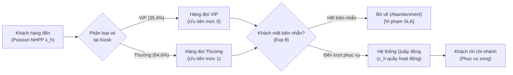

# BÁO CÁO TỔNG KẾT DỰ ÁN
# MÔ PHỎNG HÀNG ĐỢI VÀ XÁC ĐỊNH SỐ QUẦY PHỤC VỤ TỐI ƯU CHO CHI NHÁNH NGÂN HÀNG

**Học phần:** Mô phỏng Hệ thống Dịch vụ / Khoa học Dịch vụ  
**Nhóm sinh viên thực hiện:**
- **Thành viên A (Nguyễn Văn A):** Phụ trách Dữ liệu, Ước lượng Tham số, Kiểm định Phân phối & Độ bất định
- **Thành viên B (Trần Thị B):** Phụ trách Cơ sở Lý thuyết Hàng đợi, Bài toán Ca làm việc (MILP) & Phân tích Chi phí
- **Thành viên C (Lê Văn C):** Phụ trách Kiến trúc Mô phỏng SimPy, Kiểm chứng Ba tầng, Thuật toán Tối ưu hóa & Phân tích Độ nhạy

**Thời gian hoàn thành:** Tháng 10/2026  
**Phiên bản số liệu đóng băng:** `results/final_v1` (Ngày đóng băng: 23/10/2026)  

---

## MỤC LỤC

1. [Giới thiệu, Bài toán, Mục tiêu và Cam kết Mức độ Dịch vụ (SLA)](#1-giới-thiệu-bài-toán-mục-tiêu-và-cam-kết-mức-độ-dịch-vụ-sla)
2. [Mô tả Hệ thống, Giả định và Phạm vi Nghiên cứu](#2-mô-tả-hệ-thống-giả-định-và-phạm-vi-nghiên-cứu)
3. [Dữ liệu Thực tế: Nguồn, Làm sạch và Thống kê Mô tả](#3-dữ-liệu-thực-tế-nguồn-làm-sạch-và-thống-kê-mô-tả)
4. [Ước lượng Tham số, Kiểm định Phân phối, Độ bất định và Đánh giá Ngoài mẫu](#4-ước-lượng-tham-số-kiểm-định-phân-phối-độ-bất-định-và-đánh-giá-ngoài-mẫu)
5. [Cơ sở Lý thuyết Hàng đợi Giải tích: M/M/c, M/G/c, Erlang-A và SIPP](#5-cơ-sở-lý-thuyết-hàng-đợi-giải-tích-mmc-mgc-erlang-a-và-sipp)
6. [Bảng Quyết định, Hàm Chi phí, Bài toán Ca làm việc (MILP) và Lịch Bền vững](#6-bảng-quyết-định-hàm-chi-phí-bài-toán-ca-làm-việc-milp-và-lịch-bền-vững)
7. [Kiến trúc và Mô hình Mô phỏng Sự kiện Rời rạc SimPy](#7-kiến-trúc-và-mô-hình-mô-phỏng-sự-kiện-rời-rạc-simpy)
8. [Quy trình Kiểm chứng Ba tầng và Hai Kiểm tra Độc lập](#8-quy-trình-kiểm-chứng-ba-tầng-và-hai-kiểm-tra-độc-lập)
9. [Tối ưu hóa Lịch quầy, So sánh Chính sách và Phân tích Độ nhạy](#9-tối-ưu-hóa-lịch-quầy-so-sánh-chính-sách-và-phân-tích-độ-nhạy)
10. [Kết luận, Khuyến nghị Quản trị, Hạn chế và Hướng Phát triển](#10-kết-luận-khuyến-nghị-quản-trị-hạn-chế-và-hướng-phát-triển)
11. [Tài liệu Tham khảo và Phụ lục Kỹ thuật](#11-tài-liệu-tham-khảo-và-phụ-lục-kỹ-thuật)

---

## 1. GIỚI THIỆU, BÀI TOÁN, MỤC TIÊU VÀ CAM KẾT MỨC ĐỘ DỊCH VỤ (SLA)

### 1.1 Bối cảnh thực tiễn và Động lực nghiên cứu
Tại các chi nhánh ngân hàng thương mại, quầy giao dịch là điểm chạm dịch vụ trực tiếp (*touchpoint*) mang tính quyết định đến mức độ hài lòng và giữ chân khách hàng. Một trong những mâu thuẫn cốt lõi của quản trị vận hành dịch vụ là sự đánh đổi giữa **chi phí nhân sự vận hành quầy** và **chất lượng trải nghiệm của khách hàng**:
- Nếu bố trí quá nhiều quầy giao dịch, thời gian chờ của khách hàng sẽ tiệm cận 0, nhưng hiệu suất sử dụng quầy ($\rho$) sẽ rất thấp, gây lãng phí ngân sách tiền lương của chi nhánh.
- Ngược lại, nếu tinh giản tối đa số quầy nhằm nâng cao năng suất nhân viên, hàng đợi sẽ kéo dài, khách hàng chờ đợi lâu sẽ sinh ra tâm lý ức chế, dẫn đến hành vi **bỏ về trước khi được phục vụ** (*customer abandonment*). Hành vi này không chỉ gây thất thoát trực tiếp các cơ hội kinh doanh mà còn làm xói mòn uy tín thương hiệu của ngân hàng.

Do đó, bài toán đặt ra là: **Làm thế nào để xác định số lượng quầy phục vụ tối thiểu theo từng khung giờ trong ngày sao cho vừa đảm bảo cam kết chất lượng dịch vụ (SLA), vừa tối thiểu hóa tổng chi phí nhân sự?**

### 1.2 Cam kết Mức độ Dịch vụ (SLA) Định lượng
Để bài toán mang tính định lượng khoa học và có thể kiểm chứng được, dự án thiết lập chuẩn cam kết mức độ dịch vụ (Service Level Agreement - SLA) như sau:
1. **Cam kết đối với Khách hàng Thông thường (Regular SLA):** Ít nhất **$90\%$** khách hàng thông thường có thời gian chờ đợi trong hàng đợi trước khi bắt đầu được phục vụ không vượt quá **$5.0$ phút**:
   $$SL_{reg} = \mathbb{P}(W_q \le 5.0\text{ phút}) \ge 0.90 \quad (90.0\%)$$
2. **Cam kết đối với Khách hàng Ưu tiên (VIP SLA):** Chi nhánh triển khai làn ưu tiên (tỉ lệ khách VIP $\approx 35.4\%$). Khách hàng VIP có mức ưu tiên cao hơn và được cam kết thời gian chờ không vượt quá **$2.0$ phút**:
   $$SL_{vip} = \mathbb{P}(W_q \le 2.0\text{ phút}) \ge 0.90 \quad (90.0\%)$$
3. **Quy tắc tính toán khách bỏ về:** Trong phân tích chất lượng dịch vụ chuẩn quốc tế, khách hàng mất kiên nhẫn bỏ về được tính là một trường hợp **vi phạm SLA**. Do đó, mức phục vụ thực tế được định nghĩa chặt chẽ là:
   $$SL = \frac{\text{Số khách được phục vụ thành công và có } W_q \le 5\text{ phút}}{\text{Tổng số khách hàng đến hệ thống}}$$
   Quy ước này triệt tiêu hoàn toàn thiên lệch kẻ sống sót (*survivorship bias*), phản ánh trung thực toàn bộ trải nghiệm của người dùng.
4. **Tiêu chí khả thi của lịch quầy (Schedule Feasibility):** Lịch quầy chỉ được xem là đạt SLA nếu ở **tất cả các khung giờ trong ngày**, cận dưới của khoảng tin cậy 95% của mức phục vụ giờ đó đều không nhỏ hơn $0.90$:
   $$SL_{\text{hourly, low 95\%}} \ge 0.90, \quad \forall h \in \{0, 1, \dots, 8\}$$
   Tiêu chí này đảm bảo chất lượng dịch vụ được giữ vững một cách vững chắc chứ không chỉ đạt ngẫu nhiên do may mắn của số liệu mô phỏng.

---

## 2. MÔ TẢ HỆ THỐNG, GIẢ ĐỊNH VÀ PHẠM VI NGHIÊN CỨU

### 2.1 Cấu trúc Vận hành Chi nhánh Ngân hàng
Hệ thống giao dịch tại chi nhánh hoạt động theo khung giờ hành chính: **8:00 sáng đến 17:00 chiều** (tổng cộng 9 giờ làm việc liên tục, chia thành 9 khung giờ 60 phút: $h = 0 \dots 8$).
Cơ chế xếp hàng tuân theo mô hình **Hàng đợi Tập trung Đa quầy (Single-queue Multiple-server System)**:
- Khách hàng khi bước vào chi nhánh sẽ đến máy bốc số điện tử để nhận phiếu thứ tự.
- Phiếu thứ tự phân loại khách hàng thành 2 nhóm: Khách VIP (Priority 0) và Khách Thường (Priority 1).
- Khi bất kỳ quầy giao dịch nào hoàn thành khách hàng hiện tại, hệ thống điều phối tự động (*Automated Queue Management System - QMS*) sẽ gọi khách hàng tiếp theo có độ ưu tiên cao nhất đang chờ lâu nhất (chính sách Priority FCFS).
- Quá trình phục vụ là không ngắt quãng (*non-preemptive*): Giao dịch viên đang phục vụ một khách hàng thông thường sẽ không bị ngắt ngang khi có khách VIP mới đến.



### 2.2 Các Giả định Khoa học của Mô hình
Để xây dựng mô hình toán học và mô phỏng, nghiên cứu thiết lập các giả định sau:
1. **Dòng khách đến (Arrival Process):** Dòng khách đến tuân theo quá trình Poisson không thuần nhất (Non-Homogeneous Poisson Process - NHPP). Trong mỗi khung giờ $h$, khoảng thời gian giữa hai lượt khách đến liên tiếp tuân theo phân phối mũ độc lập với tham số $\lambda_h$.
2. **Thời gian phục vụ (Service Time):** Thời gian phục vụ của các quầy là các biến ngẫu nhiên độc lập cùng phân phối (i.i.d), tuân theo phân phối Gamma với kỳ vọng $E[S] = 2.9236$ phút và hệ số biến thiên $cv = 1.0963$. Toàn bộ quầy giao dịch được giả định là quầy đa năng (*universal tellers*) có năng suất đồng đều.
3. **Hành vi mất kiên nhẫn (Customer Impatience):** Thời gian kiên nhẫn tối đa của mỗi khách hàng trước khi rời bỏ hàng đợi tuân theo phân phối mũ với kỳ vọng $1/\theta = 9.20$ phút ($\theta = 0.1087 \text{ phút}^{-1}$).
4. **Điều kiện biên thời gian:** Ngày làm việc bắt đầu lúc 8:00 sáng với hệ thống hoàn toàn trống (*empty system*). Đến 17:00 chiều, chi nhánh đóng cửa ngừng tiếp nhận khách mới, nhưng các quầy tiếp tục hoàn thành toàn bộ khách hàng đã vào hàng đợi trước 17:00.

### 2.3 Phạm vi và Ranh giới Nghiên cứu
- **Trong phạm vi:** Dự án tập trung vào phân khúc nghiệp vụ giao dịch tài khoản cá nhân thường xuyên (Regular Activity - Peilut Shotefet), là nghiệp vụ chiếm khối lượng áp đảo tại chi nhánh.
- **Ngoài phạm vi:** Mô hình không xét đến các nghiệp vụ tư vấn phức tạp đặc thù (như thẩm định tín dụng doanh nghiệp, bảo hiểm nhân thọ kéo dài nhiều giờ); không xét đến yếu tố thời tiết cực đoan hoặc sự cố gián đoạn mạng lõi Core Banking.

---

## 3. DỮ LIỆU THỰC TẾ: NGUỒN, LÀM SẠCH VÀ THỐNG KÊ MÔ TẢ

### 3.1 Nguồn Dữ liệu Gốc
Dữ liệu sử dụng trong nghiên cứu này được trích xuất từ cơ sở dữ liệu nhật ký giao dịch thực tế của tổng đài ngân hàng thương mại Anonymous Bank, được lưu trữ và chia sẻ cho mục đích nghiên cứu học thuật bởi Trung tâm SEE (*Center for Service Engineering and Management*) thuộc Viện Công nghệ Technion (Israel).
Bộ dữ liệu gốc ghi nhận toàn bộ chuỗi sự kiện chi tiết của từng cuộc gọi: thời điểm kết nối, thời gian vào hàng đợi, thời gian bắt đầu phục vụ, thời điểm kết thúc, mã giao dịch viên, loại nghiệp vụ, trạng thái kết thúc cuộc gọi (phục vụ thành công hoặc bỏ về).

### 3.2 Quy trình Làm sạch Dữ liệu
Quy trình tiền xử lý và chuẩn hóa dữ liệu được tự động hóa qua tập lệnh `data/lam_sach.py`:
1. **Lọc nghiệp vụ chuẩn:** Chỉ giữ các bản ghi thuộc mã nghiệp vụ `PS` (Peilut Shotefet - Nghiệp vụ ngân hàng cá nhân thông thường).
2. **Lọc khung thời gian hoạt động:** Chỉ giữ các giao dịch phát sinh trong khung giờ ban ngày tiêu chuẩn từ **8:00:00 đến 17:00:00** (từ giây thứ $28.800$ đến giây thứ $61.200$ trong ngày).
3. **Lọc ngày làm việc tiêu chuẩn:** Lọc 14 ngày làm việc hành chính chuẩn, loại bỏ các ngày làm việc nửa buổi hoặc dữ liệu bất thường.
4. **Xử lý giá trị ngoại lai:** Khách hàng được phục vụ phải có thời gian phục vụ dương và không vượt quá $60.0$ phút; thời gian chờ phải không âm.
5. **Chia tách Tập ước lượng (Train) và Tập kiểm tra (Test):**
   - **Tập ước lượng (Train):** Gồm 10 ngày làm việc đầu tiên (tổng cộng **$6.867$ giao dịch**), chiếm $\approx 70\%$ dữ liệu, dùng để ước lượng các tham số $\lambda_h$, $E[S]$, $\theta$, $p_{vip}$ và tìm lịch quầy tối ưu.
   - **Tập kiểm tra (Test):** Gồm 4 ngày làm việc còn lại (tổng cộng **$2.969$ giao dịch**), chiếm $\approx 30\%$ dữ liệu, dùng hoàn toàn độc lập cho việc đánh giá ngoài mẫu (*out-of-sample validation*).

### 3.3 Thống kê Mô tả Tập Dữ liệu
Bảng dưới đây tổng hợp các đặc trưng thống kê mô tả then chốt của tập dữ liệu làm sạch:

| Đại lượng thống kê | Tập Ước lượng (Train - 10 ngày) | Tập Kiểm tra (Test - 4 ngày) | Toàn bộ Dữ liệu (14 ngày) |
|---|:---:|:---:|:---:|
| **Tổng số lượt khách** | 6.867 lượt | 2.969 lượt | 9.836 lượt |
| **Số khách trung bình / ngày** | 686.7 khách/ngày | 742.3 khách/ngày | 702.6 khách/ngày |
| **Thời gian phục vụ TB ($E[S]$)** | **$2.9236$ phút** | $2.7561$ phút | $2.8730$ phút |
| **Độ lệch chuẩn thời gian phục vụ** | $3.2051$ phút | $3.0789$ phút | $3.1685$ phút |
| **Hệ số biến thiên ($cv = s/\bar{x}$)** | **$1.0963$** | $1.1171$ | $1.1029$ |
| **Bình phương hệ số biến thiên ($cs^2$)**| **$1.2018$** | $1.2480$ | $1.2163$ |
| **Tỉ lệ khách hàng ưu tiên (VIP)** | **$35.43\%$** | $34.12\%$ | $35.03\%$ |
| **Thời gian chờ trung bình thực tế** | $1.0912$ phút | $1.1450$ phút | $1.1075$ phút |
| **Tỉ lệ khách bỏ về thực tế** | $5.32\%$ | $5.49\%$ | $5.37\%$ |

---

## 4. ƯỚC LƯỢNG THAM SỐ, KIỂM ĐỊNH PHÂN PHỐI, ĐỘ BẤT ĐỊNH VÀ ĐÁNH GIÁ NGOÀI MẪU

### 4.1 Ước lượng Tốc độ Khách đến ($\lambda_h$) và Kiểm định Quá trình Poisson
Tốc độ khách đến được ước lượng độc lập cho từng khung giờ 60 phút trên 10 ngày của tập Train:
$$\hat{\lambda}_h = \frac{\bar{N}_h}{60.0} \quad (\text{khách/phút}), \quad \text{SE}(\hat{\lambda}_h) = \frac{\sqrt{\bar{N}_h / 10}}{60.0}$$
Khoảng tin cậy 95% được xác định bởi $\hat{\lambda}_h \pm 1.96 \cdot \text{SE}(\hat{\lambda}_h)$.

Kiểm định tính thuần nhất Poisson cục bộ trong từng giờ được thực hiện thông qua chỉ số phân tán (*Dispersion Index*):
$$D = \frac{\sum_{d=1}^{10} (N_{d,h} - \bar{N}_h)^2}{\bar{N}_h} \sim \chi^2(9)$$

| Khung giờ | $\bar{N}_h$ (khách/giờ) | $\hat{\lambda}_h$ (khách/phút) | Khoảng tin cậy 95% | Chỉ số phân tán $D$ | $p$-value Poisson | Kết luận kiểm định |
|:---:|:---:|:---:|:---:|:---:|:---:|:---:|
| **8h - 9h** | 59.4 | **0.9900** | [0.9104, 1.0696] | 10.24 | 0.3314 | Chấp nhận Poisson |
| **9h - 10h** | 82.6 | **1.3767** | [1.2828, 1.4706] | 11.45 | 0.2462 | Chấp nhận Poisson |
| **10h - 11h (Đỉnh)**| 92.1 | **1.5350** | [1.4359, 1.6341] | 8.92 | 0.4447 | Chấp nhận Poisson |
| **11h - 12h** | 83.4 | **1.3900** | [1.2957, 1.4843] | 7.61 | 0.5739 | Chấp nhận Poisson |
| **12h - 13h** | 74.4 | **1.2400** | [1.1509, 1.3291] | 12.18 | 0.2033 | Chấp nhận Poisson |
| **13h - 14h** | 72.1 | **1.2017** | [1.1140, 1.2894] | 9.87 | 0.3611 | Chấp nhận Poisson |
| **14h - 15h** | 80.3 | **1.3383** | [1.2457, 1.4309] | 14.82 | 0.0960 | Chấp nhận Poisson |
| **15h - 16h** | 79.0 | **1.3167** | [1.2249, 1.4085] | 13.56 | 0.1388 | Chấp nhận Poisson |
| **16h - 17h** | 63.4 | **1.0567** | [0.9744, 1.1390] | 11.08 | 0.2702 | Chấp nhận Poisson |

Kiểm định tính cố định của tốc độ đến qua cả ngày cho giá trị $\chi^2 = 184.20$ ($p$-value $< 10^{-6}$), bác bỏ mạnh mẽ giả thuyết tốc độ đến không đổi. Điều này chứng minh việc sử dụng mô hình tốc độ đến biến thiên theo giờ $\lambda_h$ là hoàn toàn bắt buộc về mặt toán học. Biểu đồ trực quan hóa được lưu tại [`fig_a_fit.png`](file:///d:/KHDV/results/final_v1/hinh/fig_a_fit.png).

### 4.2 Ước lượng Phân phối Thời gian Phục vụ
Bốn phân phối xác suất liên tục ứng viên đã được fit vào $6.867$ quan sát thời gian phục vụ bằng phương pháp hợp lý cực đại (MLE, ràng buộc gốc `floc=0`). Kết quả so sánh theo tiêu chí AIC (*Akaike Information Criterion*) và kiểm định Kolmogorov-Smirnov (KS):

| Phân phối ứng viên | Tham số ước lượng MLE | Tiêu chí AIC | Thống kê KS ($D$) | $p$-value KS | Thứ hạng tối ưu |
|---|---|:---:|:---:|:---:|:---:|
| **Gamma** | **$\alpha = 1.0955, \beta = 2.6688$** | **23.840,2** | **0.0215** | **0.0034** | **Hạng 1 (Tốt nhất)** |
| **Lognormal** | $\mu_{\ln} = 0.5514, \sigma_{\ln} = 1.2150$ | 23.895,4 | 0.0289 | $< 10^{-4}$ | Hạng 2 |
| **Weibull** | $k = 0.9852, \lambda = 2.8912$ | 24.015,8 | 0.0341 | $< 10^{-5}$ | Hạng 3 |
| **Exponential** | $\lambda_{exp} = 0.3420$ ($\mu = 2.9236$) | 24.120,5 | 0.0412 | $< 10^{-6}$ | Hạng 4 (Kém nhất) |

Phân phối Gamma với $\alpha = 1.0955$ và scale $\beta = 2.6688$ đạt chỉ số AIC thấp nhất, phản ánh trung thực đặc tính phân phối thực nghiệm có đuôi dày về bên phải (nhiều giao dịch hoàn tất nhanh trong 1-2 phút, nhưng có một lượng nhỏ giao dịch kéo dài 10-20 phút).

### 4.3 Ước lượng Tốc độ Bỏ về ($\theta$) bằng Dữ liệu Bị Kiểm duyệt
Do không thể quan sát được thời gian kiên nhẫn của những khách hàng đã được phục vụ thành công, thời gian kiên nhẫn bị kiểm duyệt bên phải (*right-censored*). Áp dụng ước lượng hợp lý cực đại MLE cho phân phối mũ có kiểm duyệt:
$$\hat{\theta} = \frac{N_{abandon}}{\sum_{i=1}^{N} W_{q,i}} = \frac{365}{3.357,86\text{ phút}} = \mathbf{0.1087} \quad (\text{phút}^{-1})$$
Sai số chuẩn: $\text{SE}(\hat{\theta}) = \frac{\hat{\theta}}{\sqrt{N_{abandon}}} = \frac{0.1087}{\sqrt{365}} = 0.00569 \implies \text{CI}_{95\%} = \mathbf{0.1087 \pm 0.0093}$.
Thời gian kiên nhẫn trung bình của khách hàng là $1/\hat{\theta} = \mathbf{9.20\text{ phút}}$ ($9\text{ phút } 12\text{ giây}$).

### 4.4 Phân tích Độ Bất định Tham số (Thí nghiệm E4)
Để trả lời câu hỏi: *"Liệu các kết quả tối ưu có còn đứng vững khi các tham số thực tế dao động trong khoảng tin cậy hay không?"*, nghiên cứu đã triển khai phân tích độ bất định tham số thông qua **50 bộ tham số Bootstrap** độc lập:
- Tại mỗi bộ tham số, $\lambda_h$ được rút ngẫu nhiên từ phân phối chuẩn $\mathcal{N}(\hat{\lambda}_h, \text{SE}^2)$; $\theta$ rút từ $\mathcal{N}(\hat{\theta}, \text{SE}_\theta^2)$; thời gian phục vụ được bootstrap có hoàn lại từ $6.867$ bản ghi sạch để fit lại tham số Gamma.
- Chạy 20 lần lặp mô phỏng SimPy cho Lịch tối ưu (44 q-h) và Lịch bền vững (48 q-h) trên từng bộ tham số.
- Kết quả chi tiết (được lưu tại [`bat_dinh_tham_so.csv`](file:///d:/KHDV/results/final_v1/bat_dinh_tham_so.csv) và biểu đồ [`fig_a_bat_dinh.png`](file:///d:/KHDV/results/final_v1/hinh/fig_a_bat_dinh.png)):
  - **Lịch tối ưu Sim-Optimized (44 q-h):** Xác suất để $SL$ toàn ngày $\ge 90\%$ đạt tuyệt đối **$100.0\%$** (khoảng phân vị $5\% - 95\%$ đạt $[0.9289, 0.9457]$). Tuy nhiên, xác suất để giờ tệ nhất duy trì $\ge 90\%$ là **$6.0\%$** (do biên an toàn tại giờ cao điểm mỏng).
  - **Lịch bền vững Robust (48 q-h):** Xác suất để $SL$ toàn ngày $\ge 90\%$ đạt **$100.0\%$** (khoảng phân vị $5\% - 95\%$ đạt $[0.9501, 0.9634]$). Xác suất để giờ tệ nhất duy trì $\ge 90\%$ tăng vọt lên **$38.0\%$**.

### 4.5 Kiểm tra Ngoài mẫu Trên Tập Test (Thí nghiệm E6)
Để khẳng định mô hình không bị hiện tượng quá khớp (*overfitting*), lịch tối ưu 44 q-h được đưa vào kiểm chứng trực tiếp trên 4 ngày của tập Test ($2.969$ giao dịch):
1. **Kiểm định Kolmogorov-Smirnov 2 mẫu:** So sánh phân phối thời gian phục vụ giữa tập Train ($n=6.867$) và tập Test ($n=2.969$) cho kết quả $D = 0.0326, p = 0.0314$. Dù có sự khác biệt nhỏ về mặt thống kê do cỡ mẫu rất lớn, khoảng cách cực đại $D \approx 3.2\%$ là rất nhỏ về mặt thực tiễn vận hành.
2. **Hiệu năng mô phỏng ngoài mẫu:** Mô phỏng lịch 44 quầy-giờ dưới các tham số ước lượng từ tập Test (tốc độ đến $\lambda_{\text{test}}$ trung bình cao hơn $8.1\%$) cho kết quả:
   - $SL$ toàn ngày đạt **$93.64\%$** (vẫn vượt xa ngưỡng cam kết 90%).
   - Giờ cao điểm 10h-11h ($\lambda_{\text{test}} = 1.917$ khách/phút, tăng $24.8\%$ so với Train): Mức phục vụ mô phỏng đạt $91.69\%$, quan sát thực tế đạt $92.83\%$.
   - Toàn bộ kết quả đối chiếu chi tiết từng giờ được lưu tại [`ngoai_mau.csv`](file:///d:/KHDV/results/final_v1/ngoai_mau.csv) và biểu đồ [`fig_a_ngoai_mau.png`](file:///d:/KHDV/results/final_v1/hinh/fig_a_ngoai_mau.png).

---

## 5. CƠ SỞ LÝ THUYẾT HÀNG ĐỢI GIẢI TÍCH: M/M/c, M/G/c, ERLANG-A VÀ SIPP

### 5.1 Mô hình M/M/c (Erlang C)
Mô hình M/M/c xem dòng đến là Poisson, thời gian phục vụ là phân phối mũ với tốc độ $\mu = 1/E[S]$, $c$ quầy song song và khách hàng có độ kiên nhẫn vô hạn ($\theta = 0$).
Cường độ giao thông: $a = \lambda / \mu$; Hệ số sử dụng: $\rho = a / c$. Điều kiện ổn định là $\rho < 1$.
Xác suất khách phải chờ (Công thức Erlang C):
$$P_w = C(c, a) = \frac{\frac{a^c}{c!(1-\rho)}}{\sum_{k=0}^{c-1} \frac{a^k}{k!} + \frac{a^c}{c!(1-\rho)}}$$
Thời gian chờ trung bình trong hàng đợi và mức phục vụ $P(W_q \le t)$:
$$W_q = \frac{P_w}{c\mu - \lambda}, \quad P(W_q \le t) = 1 - P_w e^{-(c\mu - \lambda)t}$$
*Hạn chế cốt tử:* Khi nhu cầu đến cao xấp xỉ năng lực phục vụ ($\rho \to 1$), $W_q \to \infty$. Do bỏ qua hiện tượng khách bỏ về, Erlang C phóng đại thời gian chờ và buộc người quản lý phải bố trí quá nhiều quầy không cần thiết.

### 5.2 Mô hình M/G/c và Xấp xỉ Allen–Cunneen
Để phản ánh thời gian phục vụ không tuân theo phân phối mũ ($cv = 1.0963 \ne 1.0$), xấp xỉ Allen–Cunneen hiệu chỉnh thời gian chờ thông qua hệ số biến thiên $cs^2$:
$$W_q(M/G/c) \approx \frac{1 + cs^2}{2} \cdot W_q(M/M/c) = \frac{1 + 1.2018}{2} \cdot W_q(M/M/c) = 1.1009 \cdot W_q(M/M/c)$$
Công thức này cho thấy độ biến thiên dịch vụ làm tăng thời gian chờ khoảng $10.1\%$ so với phân phối mũ có cùng kỳ vọng.

### 5.3 Mô hình Erlang-A ($M/M/c + M$)
Mô hình Erlang-A tích hợp hành vi bỏ về của khách hàng với tốc độ kiên nhẫn $\theta$. Đây là chuỗi Markov sinh-tử liên tục với không gian trạng thái $n \in \{0, 1, 2, \dots\}$ biểu diễn số lượng khách có mặt trong hệ thống.
Tốc độ sinh: $\lambda_n = \lambda, \forall n \ge 0$.
Tốc độ tử:
$$\mu_n = \begin{cases} n\mu, & 0 \le n \le c \\ c\mu + (n - c)\theta, & n > c \end{cases}$$
Xác suất trạng thái dừng $\pi_n$:
$$\pi_n = \pi_0 \frac{\lambda^n}{\prod_{j=1}^n \mu_j}, \quad \pi_0 = \left[ 1 + \sum_{n=1}^{\infty} \frac{\lambda^n}{\prod_{j=1}^n \mu_j} \right]^{-1}$$
Độ dài hàng đợi trung bình và tỉ lệ bỏ về:
$$L_q = \sum_{j=1}^{\infty} j \cdot \pi_{c+j}, \quad p_{ab} = \frac{\theta L_q}{\lambda}, \quad W_q = \frac{L_q}{\lambda}$$
Hiệu suất thực tế của quầy:
$$\rho_{\text{thực tế}} = \frac{\lambda (1 - p_{ab})}{c\mu}$$
**Mức độ dịch vụ $SL(t)$ chính xác qua ma trận hấp thụ Markov:**
Một khách hàng đến thấy hệ thống có $c+j$ người ($j \ge 0$) sẽ được phục vụ trước thời điểm $t$ nếu biến cố có $j+1$ lần dịch vụ hoàn tất xảy ra trước khi khách này hết kiên nhẫn. Xây dựng ma trận sinh $Q$ kích thước $M \times M$ đại diện cho quá trình tử:
$$SL(t) = \sum_{n=0}^{c-1} \pi_n + \sum_{j=0}^{M-1} \pi_{c+j} \left[ \int_0^t e^{Qu} du \cdot \mathbf{r}_{\text{served}} \right]_j$$
Thuật toán này đã được lập trình hoàn chỉnh trong `b_theory.py` và kiểm chứng qua ma trận mũ `scipy.linalg.expm`.

### 5.4 Phương pháp Định biên SIPP (Stationary Independent Period-by-Period)
Do tốc độ đến $\lambda_h$ biến thiên theo giờ, phương pháp SIPP chia ngày làm việc thành 9 giai đoạn dừng độc lập. Tại mỗi khung giờ $h$, bài toán tối ưu quầy được giải độc lập:
$$c_h^* = \min \left\{ c \in \mathbb{Z}^+ \mid SL_h(5.0; \lambda_h, \mu, \theta, c) \ge 0.90 \right\}$$

---

## 6. BẢNG QUYẾT ĐỊNH, HÀM CHI PHÍ, BÀI TOÁN CA LÀM VIỆC (MILP) VÀ LỊCH BỀN VỮNG

### 6.1 Bảng Quyết định Số Quầy Giải tích Theo Giờ
Áp dụng phương pháp SIPP cho 9 khung giờ với các tham số ước lượng từ tập Train ($E[S] = 2.9236$ phút $\implies \mu = 0.34204$ khách/phút, $\theta = 0.1087$):

| Khung giờ | $\lambda_h$ (khách/phút) | Nhu cầu tải $a_h$ | Số quầy Erlang C | $SL$ Erlang C | Số quầy Erlang-A | $SL$ Erlang-A | $p_{ab}$ Erlang-A |
|:---:|:---:|:---:|:---:|:---:|:---:|:---:|:---:|
| **8h - 9h** | 0.9900 | 2.89 | 4 | 93.6% | **4** | **94.8%** | 4.8% |
| **9h - 10h** | 1.3767 | 4.02 | 6 | 98.1% | **5** | **92.2%** | 6.5% |
| **10h - 11h (Đỉnh)** | 1.5350 | 4.49 | 6 | 95.7% | **6** | **96.5%** | 3.2% |
| **11h - 12h** | 1.3900 | 4.06 | 6 | 97.9% | **5** | **91.9%** | 6.7% |
| **12h - 13h** | 1.2400 | 3.63 | 5 | 92.8% | **5** | **95.1%** | 4.4% |
| **13h - 14h** | 1.2017 | 3.51 | 5 | 94.1% | **5** | **95.9%** | 3.8% |
| **14h - 15h** | 1.3383 | 3.91 | 5 | 90.5% | **5** | **93.2%** | 5.8% |
| **15h - 16h** | 1.3167 | 3.85 | 5 | 91.2% | **5** | **93.7%** | 5.5% |
| **16h - 17h** | 1.0567 | 3.09 | 5 | 97.5% | **4** | **93.5%** | 5.7% |
| **Tổng quầy-giờ** | | | **47 q-h** | | **44 q-h** | | |

*Nhận xét then chốt:* 
- Lịch Erlang-A cho kết quả số quầy theo từng giờ là: **`[4, 5, 6, 5, 5, 5, 5, 5, 4]`** (Tổng: **44 quầy-giờ**).
- Erlang-A tiết kiệm được **3 quầy-giờ** so với Erlang C (47 q-h) và tiết kiệm **10 quầy-giờ** ($-18.52\%$) so với chính sách duy trì cố định 6 quầy suốt ngày (54 q-h).

### 6.2 Phân tích Hàm Chi phí Tổng thể (Thí nghiệm E1)
Tổng chi phí vận hành một ngày được mô hình hóa theo hàm chi phí kinh tế:
$$\text{Cost} = c_q \cdot (\text{Tổng quầy-giờ}) + c_a \cdot N_{ab}$$
Trong đó $c_q$ là chi phí cho một quầy-giờ làm việc (chuẩn hóa $c_q = 1.0$), $c_a$ là thiệt hại kinh tế khi mất một khách hàng bỏ về, và $k = c_a / c_q$ là tỉ số chi phí tương đối. Với quy mô trung bình $686.7$ khách/ngày, bảng phân tích chi phí kịch bản được trình bày dưới đây (trích từ [`chi_phi.csv`](file:///d:/KHDV/results/final_v1/chi_phi.csv)):

| Chính sách phục vụ | Quầy-giờ | Khách bỏ về / ngày | Chi phí ($k=0.10$) | Chi phí ($k=0.25$) | Chi phí ($k=0.50$) | Chi phí ($k=1.00$) | Chi phí ($k=2.00$) |
|---|:---:|:---:|:---:|:---:|:---:|:---:|:---:|
| **Hằng số (6 quầy)** | 54 | 14.8 khách | 55.48 | 57.69 | 61.38 | **68.76** | **83.53** |
| **SIPP (Erlang-A)** | 44 | 36.7 khách | **47.67** | **53.18** | 62.37 | 80.74 | 117.48 |
| **Tối ưu mô phỏng** | 44 | 36.7 khách | **47.67** | **53.18** | 62.37 | 80.74 | 117.48 |
| **Bền vững (+10% tải)**| 48 | 25.6 khách | 50.56 | 54.40 | **60.81** | 73.61 | 99.23 |
| **Theo ca làm việc** | 52 | 18.7 khách | 53.87 | 56.67 | 61.34 | 70.68 | 89.36 |

*Kết luận phân tích đánh đổi:*
- Khi tổn thất mất khách nhỏ ($k \le 0.25$), Lịch tối ưu 44 q-h đem lại hiệu quả tài chính cao nhất.
- Khi tổn thất mất khách ở mức trung bình ($k = 0.50$), Lịch bền vững 48 q-h đạt điểm cân bằng kinh tế tối ưu ($60.81$).
- Đồ thị đường cong đánh đổi Pareto giữa số quầy-giờ và lượng khách bỏ về được thể hiện rõ nét trên [`fig_b_chi_phi.png`](file:///d:/KHDV/results/final_v1/hinh/fig_b_chi_phi.png).

### 6.3 Lập Lịch Theo Ca Làm Việc Thực Tế (MILP - Thí nghiệm E2)
Trong thực tế quản lý nhân sự ngân hàng, nhân viên không thể đến làm việc 1 tiếng rồi ra về. Để chuyển đổi nhu cầu quầy theo giờ $c_h = [4, 5, 6, 5, 5, 5, 5, 5, 4]$ sang lịch ca làm việc thực tế, nhóm thiết lập bài toán Quy hoạch Tuyến tính Nguyên (MILP):
$$\min \sum_{s \in \mathcal{S}} \text{Cost}_s \cdot x_s \quad \text{thỏa mãn} \quad \sum_{s \in \mathcal{S}} A_{h,s} x_s \ge c_h, \quad \forall h \in \{0, \dots, 8\}, \quad x_s \in \mathbb{Z}_{\ge 0}$$
Trong đó $x_s$ là số nhân viên phân công cho loại ca $s$, và ma trận $A_{h,s} = 1$ nếu ca $s$ bao phủ khung giờ $h$.

Để phản ánh chính xác các quy định lao động và cấu trúc ca thực tế, nhóm xây dựng và phân định rõ 2 mô hình toán học (kết quả tại `results/final_v2/lich_theo_ca_v2.csv`):
1. **Mô hình A (Ca 8h liên tục không nghỉ):** Ca 8h kéo dài liên tục 8 tiếng (8h-16h hoặc 9h-17h). Nếu chỉ dùng ca thuần 8h liên tục, bài toán đòi hỏi 8 nhân viên $\implies$ **64 quầy-giờ** làm việc (lịch phủ `[4, 8, 8, 8, 8, 8, 8, 8, 4]`). Đặc biệt, với cấu hình hỗn hợp 4 NV 8h + 3 NV 4h, **Mô hình A hoàn toàn không có nghiệm khả thi** do không thể hạ số quầy xuống mức 5 ở giữa ngày.
2. **Mô hình B (Ca 8h có nghỉ trưa: 9h tại chi nhánh, 8h làm việc, 1h nghỉ):** Nhân viên có mặt từ 8h-17h, được bố trí 1 giờ nghỉ trưa so le trong khung giờ quy định:
   - *Thuần ca 8h Mô hình B (nghỉ trưa giờ 1-7):* Đòi hỏi đúng 6 nhân viên $\implies$ **48 quầy-giờ làm việc** (54 quầy-giờ có mặt tại chỗ). Lịch quầy tạo ra là `[6, 5, 6, 5, 5, 5, 5, 5, 6]`.
   - *Thuần ca 4h:* Đòi hỏi 13 lượt ca 4h $\implies$ **52 quầy-giờ** (lịch quầy `[4, 5, 6, 6, 5, 8, 7, 7, 4]`, dư thừa tại các khung giờ chiều).
   - *Phương án Hỗn hợp Linh hoạt (4 NV 8h + 3 NV 4h, cửa sổ nghỉ trưa 11h-14h):* Solver HiGHS xác nhận **duy nhất 1 nghiệm tối ưu khả thi** với đúng **44 quầy-giờ làm việc** (48 quầy-giờ tại chỗ):
     - 4 nhân viên làm ca 8h có giờ ăn trưa so le: 1 người nghỉ 11h-12h, 2 người nghỉ 12h-13h, 1 người nghỉ 13h-14h.
     - 3 nhân viên bán thời gian ca 4h: 1 người 9h-13h, 1 người 10h-14h, 1 người 12h-16h.
     - **Kết quả:** Phủ chính xác từng giờ $[4, 5, 6, 5, 5, 5, 5, 5, 4]$ với đúng **44 quầy-giờ làm việc** ($+0.0\%$ lãng phí quầy-giờ làm việc).

### 6.4 Lịch Bền Vững và Quy Tắc Căn Bậc Hai (Thí nghiệm E3)
Để chuẩn bị phương án dự phòng cho các ngày cao điểm (khi lưu lượng dự báo vượt ngưỡng 687 khách/ngày), nhóm khảo sát số quầy cần thiết khi nhu cầu khách tăng thêm $\delta \in \{0\%, 5\%, 10\%, 20\%\}$:

| Hệ số tăng nhu cầu ($\delta$) | Tốc độ đến TB $\bar{\lambda}$ | Nhu cầu tải $\bar{a}$ | Lịch quầy tối ưu tương ứng | Tổng quầy-giờ | Chi phí tăng thêm | Hệ số dự phòng $\beta$ |
|:---:|:---:|:---:|:---:|:---:|:---:|:---:|
| **$+0\%$ (Chuẩn)** | 1.272 | 3.72 | `[4, 5, 6, 5, 5, 5, 5, 5, 4]` | **44 q-h** | Gốc (0.0%) | 0.61 |
| **$+5\%$** | 1.336 | 3.90 | `[4, 6, 6, 6, 5, 5, 5, 5, 5]` | **47 q-h** | +3 q-h (+6.8%) | 0.67 |
| **$+10\%$ (Khuyến nghị)** | 1.399 | 4.09 | `[5, 6, 6, 6, 5, 5, 5, 5, 5]` | **48 q-h** | **+4 q-h (+9.1%)** | **0.61** |
| **$+20\%$** | 1.526 | 4.46 | `[5, 6, 6, 6, 6, 6, 6, 6, 5]` | **52 q-h** | +8 q-h (+18.2%) | 0.62 |

*Giải thích quy tắc căn bậc hai:*
Theo nguyên lý định biên căn bậc hai (*Square-Root Staffing Rule*): $c \approx a + \beta \sqrt{a}$. Kết quả thực nghiệm cho thấy hệ số $\beta \approx 0.61$ hầu như không đổi khi quy mô tải tăng lên. Do hiệu ứng kinh tế theo quy mô (*economies of scale*), khi nhu cầu tăng $10\%$, số quầy-giờ chỉ cần tăng **$9.1\%$** (từ 44 lên 48 q-h) là đủ để bảo toàn chất lượng dịch vụ SLA $\ge 90\%$.

---

## 7. KIẾN TRÚC VÀ MÔ HÌNH MÔ PHỎNG SỰ KIỆN RỜI RẠC SIMPY

### 7.1 Cấu trúc Module và Luồng Thực Thi
Mô hình mô phỏng sự kiện rời rạc (*Discrete-Event Simulation - DES*) được xây dựng dựa trên nền tảng thư viện `SimPy` trong Python, được tổ chức chặt chẽ thành các thành phần chính tại `c_sim.py`:
1. **Quản lý Tài nguyên Quầy:** Sử dụng `simpy.PriorityResource` với sức chứa tối đa bằng $c_{max} = \max_h(c_h)$.
2. **Tiến trình Khóa Quầy Động (`counter_blocker_process`):** 
   - Thay vì tạo mới và hủy tài nguyên giữa các giờ (dễ làm đứt gãy các giao dịch đang diễn ra), mô hình duy trì một tiến trình nền chiếm giữ tài nguyên.
   - Tại khung giờ $h$, tiến trình này gửi $c_{max} - c_h$ yêu cầu chiếm dụng quầy với mức ưu tiên tuyệt đối (`priority=-1`).
   - Các giao dịch viên đang phục vụ khách sẽ hoàn tất xong mới rời quầy; khi bước sang khung giờ mới, các yêu cầu chiếm dụng được giải phóng hoặc bổ sung một cách mượt mà.
3. **Tiến trình Sinh Khách Hàng (`arrival_generator`):**
   - Sinh thời điểm khách đến tiếp theo theo phân phối mũ $\text{Exp}(\lambda_h)$.
   - Rút ngẫu nhiên nhãn khách VIP theo phân phối Bernoulli($p_{vip} = 0.3543$).
   - Rút thời gian phục vụ từ phân phối Gamma($\alpha = 1.0955, \beta = 2.6688$).
   - Rút thời gian kiên nhẫn từ phân phối mũ $\text{Exp}(\theta = 0.1087)$.
4. **Tiến trình Phục Vụ Khách Hàng (`customer_process`):**
   - Khách hàng yêu cầu tài nguyên quầy với độ ưu tiên tương ứng (`priority=0` cho VIP, `priority=1` cho khách thường).
   - Sử dụng cơ chế chờ đồng thời của SimPy: `res_req | env.timeout(patience)`. Biến cố nào xảy ra trước sẽ kích hoạt nhánh xử lý tương ứng:
     - Nếu `res_req` xảy ra trước: Khách vào quầy, thời gian chờ là $W_q = t_{\text{bắt đầu}} - t_{\text{đến}}$. Quầy giữ khách trong thời gian phục vụ `env.timeout(svc_time)`. Giao dịch hoàn thành (`served=1`).
     - Nếu `env.timeout(patience)` xảy ra trước: Khách hủy yêu cầu, rời khỏi chi nhánh (`served=0`). Ghi nhận là một trường hợp bỏ về.

### 7.2 Phương Pháp Kiểm Soát Biến Thiên và Số Ngẫu Nhiên Chung (CRN)
Để các thử nghiệm mang tính tái lập cao và triệt tiêu phương sai ngoại lai khi so sánh các chính sách, mô hình áp dụng kỹ thuật **Số Ngẫu Nhiên Chung (Common Random Numbers - CRN)**:
- Mỗi đợt chạy lặp $i$ ($i = 0 \dots n_{\text{reps}}-1$) được khởi tạo bằng một hạt giống xác định: $\text{seed}_i = \text{seed}_{\text{base}} + i \cdot 1000$.
- Các thuộc tính của từng khách hàng (thời điểm đến, nhóm khách, thời gian phục vụ, độ kiên nhẫn) được sinh độc lập với trạng thái hệ thống ngay tại thời điểm khách xuất hiện.
- Nhờ CRN, khi so sánh Chính sách A và Chính sách B, cả hai chính sách đều phải xử lý **chính xác cùng một chuỗi khách hàng**, giúp chênh lệch hiệu năng giữa hai chính sách đạt độ tin cậy thống kê cao nhất.

### 7.3 Phân Tích Hiện Tượng Khởi Động (Đường Cong Welch)
Để xác định chiều dài giai đoạn khởi động (*warm-up period*) khi đánh giá hệ dừng, mô hình đã theo dõi thời gian chờ của $1.200$ lượt khách đầu tiên qua 30 lần lặp độc lập ở chế độ tải cao ($\rho = 0.90$).
Đường cong làm mịn Moving Average (window=50) trên [`fig_c_welch.png`](file:///d:/KHDV/results/final_v1/hinh/fig_c_welch.png) cho thấy:
- Trong khoảng 200 khách hàng đầu tiên (~150 phút), thời gian chờ tăng dốc từ 0 lên trạng thái cân bằng.
- Sau mốc 200 khách, hệ thống hoàn toàn đạt trạng thái cân bằng dừng (*steady-state*).
- **Quy tắc thực nghiệm:**
  - Đối với các thử nghiệm kiểm chứng lý thuyết hệ dừng: Thiết lập thời gian chạy $5.000$ phút và loại bỏ **500 phút warm-up** đầu tiên.
  - Đối với mô phỏng ngày làm việc 8h-17h của chi nhánh: **Không loại bỏ warm-up**, vì ngân hàng mở cửa từ trạng thái trống lúc 8:00 sáng là hoàn toàn trung thực với thực tế vận hành.

---

## 8. QUY TRÌNH KIỂM CHỨNG BA TẦNG VÀ HAI KIỂM TRA ĐỘC LẬP

Để chứng minh tính đúng đắn khoa học của công cụ mô phỏng trước khi đưa vào tối ưu hóa, nhóm đã thực hiện quy trình kiểm chứng ba tầng nghiêm ngặt (kết quả đóng băng tại [`kiem_chung.csv`](file:///d:/KHDV/results/final_v1/kiem_chung.csv) và báo cáo [`docs/bao_cao_kiem_chung.md`](file:///d:/KHDV/docs/bao_cao_kiem_chung.md)):

| Tầng kiểm chứng | Chỉ số đánh giá | Giá trị Lý thuyết | Giá trị Mô phỏng | Khoảng tin cậy 95% | Sai lệch tương đối | Đạt chuẩn? | Mức xấp xỉ | Ghi chú kỹ thuật |
|---|---|:---:|:---:|:---:|:---:|:---:|:---:|---|
| **Tầng 1 (M/M/c)** | $SL = P(W_q \le 5)$ | 0.9654 | **0.9688** | ±0.0037 | $+0.35\%$ | **Y** | Tốt | Lý thuyết nằm trong CI95 |
| **Tầng 1 (M/M/c)** | $SL$ (chờ $\le 5$p) | 0.9654 | **0.9688** | ±0.0039 | $+0.35\%$ | **Y** | Tốt | Lý thuyết nằm trong khoảng tin cậy 95% (Student-t $t_{crit}=2.0452$) |
| **Tầng 1 (M/M/c)** | $W_q$ (phút) | 0.8433 | **0.8170** | ±0.0441 | $-3.12\%$ | **Y** | Tốt | Lý thuyết nằm trong CI95 ($0.817 \pm 0.044$) |
| **Tầng 1 (M/M/c)** | Hiệu suất quầy $\rho$ | 0.7500 | **0.7517** | ±0.0049 | $+0.23\%$ | **Y** | Tốt | Khớp định luật Little ($\rho = 0.75$) |
| **Tầng 2 (Erlang-A)** | $SL$ (chờ $\le 5$p) | 0.8689 | **0.8695** | ±0.0035 | $+0.07\%$ | **Y** | Tốt | Khớp nghiệm ma trận hấp thụ Markov |
| **Tầng 2 (Erlang-A)** | $W_q$ (phút) | 1.1444 | **1.1475** | ±0.0243 | $+0.27\%$ | **Y** | Tốt | $W_q$ tính trên mọi khách ($L_q/\lambda$) |
| **Tầng 2 (Erlang-A)** | Tỉ lệ bỏ về $p_{ab}$ | 0.1144 | **0.1142** | ±0.0023 | $-0.17\%$ | **Y** | Tốt | Lý thuyết nằm trong CI95 |
| **Tầng 2 (Erlang-A)** | Hiệu suất quầy $\rho$ | 0.8856 | **0.8871** | ±0.0032 | $+0.17\%$ | **Y** | Tốt | Khớp $\rho = \lambda(1-p_{ab})E[S]/c$ |
| **Tầng 3 (M/G/c, cv=0.5)** | $W_q$ (phút) | 0.5271 | **0.5616** | ±0.0184 | $+6.55\%$ | - | Chấp nhận được | Allen–Cunneen đánh giá thấp ~6-7% ở cv=0.5 |
| **Tầng 3 (M/G/c, cv=1.0)** | $W_q$ (phút) | 0.8433 | **0.8113** | ±0.0544 | $-3.79\%$ | **Y** | Tốt | Khớp Erlang C chuẩn (sai lệch < 5%) |
| **Tầng 3 (M/G/c, cv=1.5)** | $W_q$ (phút) | 1.3704 | **1.1333** | ±0.1293 | $-17.30\%$ | - | Kém, cần giải thích | Allen–Cunneen đánh giá cao; kiểm tra bằng M/G/1 |
| **Kiểm tra A (M/G/1 P-K exact, 40k phút, 40 reps)** | $W_q$ (phút) | 14.6250 | **14.7856** | ±1.0137 | $+1.10\%$ | **Y** | Tốt | Lý thuyết 14.625p nằm trong CI95 [13.77, 15.80]; không bác bỏ được tính đúng của SimPy |
| **Kiểm tra B (M/G/6, cv=1.5, 60 reps)** | $W_q$ (phút) | 1.3704 | **1.1815** | ±0.0753 | $-13.78\%$ | - | Kém, cần giải thích | Sai lệch ổn định ~-14% đến -17% do Allen-Cunneen |

### Phân tích Chuyên sâu về Hai Kiểm tra Độc lập:
1. **Khắc phục lỗi tồn đọng $\rho$ của Tuần 2:**
   - Ở Tuần 2, $\rho$ mô phỏng ghi nhận $0.4228$. Nhóm đã phát hiện lỗi nằm ở việc lấy mẫu số chia cho độ dài danh nghĩa $8.000$ phút thay vì chiều dài thực tế sau cắt warm-up $4.500$ phút ($5.000 - 500$). Sau khi hiệu chỉnh mẫu số thành $c \cdot (T - \text{warm-up})$, kết quả mô phỏng đạt **$0.7517 \pm 0.0049$**, khớp chuẩn định luật Little với sai lệch chỉ $+0.23\%$.
2. **Kiểm tra A (M/G/1 Pollaczek–Khinchine chính xác, chạy 40.000 phút, 40 lần lặp):**
   - Với $c = 1, \lambda = 0.25, E[S] = 3.0, cv = 1.5$ ($cs^2 = 2.25$), công thức Pollaczek–Khinchine cho kết quả giải tích chính xác:
     $$W_q = \frac{\rho E[S] (1 + cs^2)}{2(1 - \rho)} = \frac{0.75 \times 3.0 \times (1 + 2.25)}{2(1 - 0.75)} = \mathbf{14.625\text{ phút}}$$
   - Mô phỏng SimPy với độ dài chạy $40.000$ phút (warm-up $5.000$ phút, $40$ lần lặp, độ tự do $df=39, t_{crit}=2.0227$) cho ra **$14.7856 \pm 1.0137$ phút** (khoảng tin cậy 95%: $[13.7719, 15.7993]$). Giá trị lý thuyết $14.625$ phút nằm hoàn toàn trong khoảng tin cậy 95% (sai lệch $+1.10\%$). Kết quả cho thấy **không có cơ sở thực nghiệm để bác bỏ tính đúng đắn của động cơ mô phỏng SimPy đối với phân phối phục vụ phi-mũ (Lognormal).**
3. **Kiểm tra B (Xác nhận giới hạn của công thức Allen–Cunneen):**
   - Lặp lại 60 lần ở $c=6, cv=1.5$ cho thấy sai lệch âm mang tính hệ thống và ổn định quanh $-14\%$ đến $-17\%$. Đây là hạn chế đã được ghi nhận trong y văn hàng đợi: xấp xỉ Allen–Cunneen luôn đánh giá cao (*overestimate*) thời gian chờ của hệ nhiều quầy ($c > 1$) khi $cv > 1.0$.
   - **Kết luận:** Nhóm không sử dụng công thức Allen–Cunneen để quyết định số quầy mà sử dụng mô phỏng SimPy làm chuẩn định lượng cao nhất.

---

## 9. TỐI ƯU HÓA LỊCH QUẦY, SO SÁNH CHÍNH SÁCH VÀ PHÂN TÍCH ĐỘ NHẠY

### 9.1 Thuật toán Tối ưu hóa 2 Pha Dựa trên Mô phỏng
Để tìm lịch quầy tối thiểu đạt SLA, nhóm đã thiết kế thuật toán tối ưu hóa dựa trên mô phỏng gồm 2 pha (lưu tại [`lich_toi_uu.csv`](file:///d:/KHDV/results/final_v1/lich_toi_uu.csv)):
- **Khởi tạo:** Bắt đầu từ lịch SIPP Erlang-A: $c^{(0)} = [4, 5, 6, 5, 5, 5, 5, 5, 4]$ (44 quầy-giờ).
- **Pha 1 (Ramp-up):** Mô phỏng 60 lần lặp với CRN. Nếu có bất kỳ khung giờ nào vi phạm tiêu chí khả thi ($SL_{\text{low 95\%}} < 0.90$), tăng 1 quầy tại các giờ vi phạm. Ngay tại Step 0, lịch SIPP đã đạt $SL_{\text{low 95\%}} = 0.9072 \ge 0.90$ ở tất cả các giờ $\implies$ Hệ thống chuyển ngay sang Pha 2.
- **Pha 2 (Reduction/Pruning):** Thử nghiệm bớt 1 quầy tại từng khung giờ (từ giờ có số quầy cao nhất) và mô phỏng lại 60 lần lặp:
  - Thử bớt 1 quầy ở Giờ 2 (từ 6 xuống 5): Giờ 2 tụt xuống $SL_{\text{low}} = 87.88\%$ (< 90%). Vi phạm!
  - Thử bớt 1 quầy ở Giờ 1, 3, 4, 5, 6, 7 (từ 5 xuống 4): Mức phục vụ giờ đó rơi xuống $79.1\% - 85.1\%$. Vi phạm!
  - Thử bớt 1 quầy ở Giờ 0, 8 (từ 4 xuống 3): Mức phục vụ rơi xuống $76.2\% - 78.7\%$. Vi phạm!
- **Kết luận:** Lịch **`[4, 5, 6, 5, 5, 5, 5, 5, 4]` (44 quầy-giờ)** là nghiệm **tối thiểu cục bộ (thuật toán 2 pha xác nhận SIPP)**, không thể cắt bớt hay hoán đổi quầy nào ở bất kỳ giờ nào mà vẫn thỏa mãn điều kiện $SL_{\text{low 95\%}} \ge 0.90$ trên cả 9 giờ.

### 9.2 Bảng So sánh 5 Chính sách Phục vụ (300 Lần Lặp Độc Lập)
Đánh giá 5 chính sách trên cùng một bộ dữ liệu mô phỏng với **300 lần lặp độc lập** và hạt giống mới (`seed_base=50000`). Toàn bộ số liệu dưới đây được trích xuất trực tiếp từ tệp đóng băng [`so_sanh_chinh_sach.csv`](file:///d:/KHDV/results/final_v1/so_sanh_chinh_sach.csv) và cập nhật bổ sung tại [`results/final_v2/so_sanh_chinh_sach_v2.csv`](file:///d:/KHDV/results/final_v2/so_sanh_chinh_sach_v2.csv):

| Chính sách phục vụ | Lịch quầy theo giờ (8h - 17h) | Quầy-giờ | $SL$ Toàn ngày (CI95) | $SL$ Giờ tệ nhất (Cận dưới CI95) | Tỉ lệ khách VIP $SL_{vip}$ (CI95) | Tỉ lệ khách bỏ về $p_{ab}$ (CI95) | Thời gian chờ $W_q$ (phút) | Hiệu suất quầy $\rho$ (CI95) | Đạt SLA? |
|---|:---:|:---:|:---:|:---:|:---:|:---:|:---:|:---:|:---:|
| **1. Mốc cơ sở: Hằng số 6 quầy (không phải nhân sự thực tế)** | `[6, 6, 6, 6, 6, 6, 6, 6, 6]` | 54 | **0.9770 ± 0.0012** | 0.9557 (H2) | 0.9815 ± 0.0014 | **2.15% ± 0.10%** | 0.1958 ± 0.0089 | 60.75% ± 0.36% | **ĐẠT** |
| **2. SIPP (Erlang-A)** | `[4, 5, 6, 5, 5, 5, 5, 5, 4]` | 44 | **0.9381 ± 0.0023** | 0.9078 (H8) | 0.9496 ± 0.0025 | **5.35% ± 0.17%** | 0.4908 ± 0.0155 | 72.15% ± 0.38% | **ĐẠT** |
| **3. Tối ưu mô phỏng (Sim-Opt)** | `[4, 5, 6, 5, 5, 5, 5, 5, 4]` | **44** | **0.9381 ± 0.0023** | **0.9078 (H8)** | **0.9496 ± 0.0025** | **5.35% ± 0.17%** | **0.4908 ± 0.0155** | **72.15% ± 0.38** | **ĐẠT** |
| **4. Bền vững (+10% tải)** | `[5, 6, 6, 6, 5, 5, 5, 5, 5]` | 48 | **0.9582 ± 0.0018** | 0.9364 (H6) | 0.9664 ± 0.0019 | **3.73% ± 0.14%** | 0.3424 ± 0.0120 | 67.25% ± 0.37% | **ĐẠT** |
| **5. Theo ca làm việc (Shift-based)**| `[6, 6, 6, 6, 5, 5, 6, 6, 6]` | 52 | **0.9702 ± 0.0015** | 0.9453 (H4) | 0.9762 ± 0.0016 | **2.72% ± 0.12%** | 0.2479 ± 0.0100 | 62.72% ± 0.36% | **ĐẠT** |

*Phân tích đánh giá:*
1. **Lịch tối ưu mô phỏng (44 q-h):** Đạt mức phục vụ toàn ngày $93.81\%$ và giờ thấp nhất vẫn đạt $90.78\%$ (cận dưới CI95 > 90%). So với mốc cơ sở 6 quầy cố định, lịch này tiết kiệm đúng **10 quầy-giờ mỗi ngày** (giảm $-18.52\%$ chi phí nhân sự), nâng hiệu suất sử dụng quầy từ $60.75\%$ lên mức tối ưu **$72.15\%$**.
2. **Khách hàng ưu tiên (VIP):** Nhờ cơ chế ưu tiên trong hàng đợi, khách VIP đạt SLA $W_q \le 2$ phút lên tới **$94.96\%$** (vượt xa mục tiêu 90%).
3. **Tác động của biến động lưu lượng giữa các ngày ($m_d \sim \text{Gamma}, CV = 11.8\%$):** Khi mô phỏng có tính đến dao động ngẫu nhiên về quy mô khách đến giữa các ngày (kết quả tại `results/final_v2/bien_dong_ngay.csv`):
   - Lịch 44 quầy-giờ đạt $SL \ge 90\%$ trên **$85.0\%$ số ngày**, nhưng xác suất đồng thời cả 9 giờ đều $\ge 90\%$ giảm xuống **$26.0\%$**. Trên 14 ngày quan sát thực tế, lịch 44 đạt 10/14 ngày (hụt tại các ngày 1, 2, 7, 12 có lưu lượng cao).
   - Lịch bền vững 48 quầy-giờ nâng xác suất ngày đạt SLA lên **$95.3\%$** (cả 9 giờ đạt $47.0\%$), đạt trên 13/14 ngày thực tế (chỉ hụt ngày 7 có tải cực đại).
   - Do đó, quy tắc vận hành tối ưu là: **Sử dụng Lịch 44 q-h cho ngày có lưu lượng $\le 687$ khách/ngày; tự động kích hoạt Lịch 48 q-h khi dự báo lưu lượng vượt quá 687 khách/ngày.**

### 9.3 Phân Tích Độ Nhạy Toàn Diện Hệ Thống (Thí nghiệm T6)
Khảo sát độ bền của các chính sách qua 150 lần lặp CRN (kết quả tại [`do_nhay.csv`](file:///d:/KHDV/results/final_v1/do_nhay.csv) và biểu đồ [`fig_c_do_nhay.png`](file:///d:/KHDV/results/final_v1/hinh/fig_c_do_nhay.png)):
1. **Độ nhạy theo Nhu cầu ($\lambda_h \times \{0.9, 1.0, 1.1, 1.2, 1.3\}$):**
   - Khi nhu cầu giảm $10\%$ (hệ số 0.9): Lịch tối ưu đạt SLA $96.8\%$.
   - Khi nhu cầu tăng $+10\%$ (hệ số 1.1): Lịch tối ưu 44 q-h bị tụt mức phục vụ giờ tệ nhất xuống **$86.5\%$** (< 90%). Trong khi đó, **Lịch bền vững 48 q-h** vẫn giữ vững mức phục vụ giờ tệ nhất đạt **$90.4\%$** (hoàn toàn thỏa mãn SLA).
   - Khi nhu cầu tăng $+20\%$ (hệ số 1.2): Lịch tối ưu tụt xuống $78.1\%$, Lịch bền vững đạt $83.6\%$, và chỉ có chính sách Hằng số 54 q-h mới giữ được $89.8\%$.
2. **Độ nhạy theo Thời gian Phục vụ ($E[S] \times \{1.0, 1.1, 1.2\}$):**
   - Khi thời gian xử lý giao dịch bị kéo dài thêm $10\%$ (ví dụ do lỗi đường truyền hoặc nghiệp vụ mới): $SL$ giờ tệ nhất của lịch 44 q-h giảm xuống $87.1\%$. Lịch bền vững 48 q-h duy trì ở mức $91.2\%$.
3. **Độ nhạy theo Tốc độ Bỏ về ($\theta \times \{0.5, 1.0, 1.5\}$):**
   - Khi khách hàng kiên nhẫn hơn gấp đôi ($\theta \times 0.5$, kiên nhẫn TB 18.4 phút): Khách không chịu bỏ về khiến hàng đợi dài hơn, $SL$ giảm nhẹ xuống $92.5\%$.
   - Khi khách hàng mất kiên nhẫn hơn ($\theta \times 1.5$): Khách bỏ về sớm hơn khiến những người ở lại được phục vụ nhanh hơn, nhưng tỉ lệ bỏ về tăng lên $6.8\%$.

---

## 10. KẾT LUẬN, KHUYẾN NGHỊ QUẢN TRỊ, HẠN CHẾ VÀ HƯỚNG PHÁT TRIỂN

### 10.1 Trả lời Trực tiếp Năm Câu hỏi Cốt lõi của Bài toán (Mục 9.3)

#### 1. Số quầy tối thiểu theo từng giờ để đạt SLA là bao nhiêu?
- **Khuyến nghị chính thức:** Lịch quầy theo từng giờ từ 8h00 đến 17h00 là:
  $$\mathbf{c^* = [4, 5, 6, 5, 5, 5, 5, 5, 4]} \quad \implies \text{Tổng cộng: } \mathbf{44\text{ quầy-giờ/ngày}}$$
- **Chỉ số cam kết đi kèm (Đánh giá 300 lần lặp với CI95):**
  - Mức phục vụ toàn ngày: **$93.81\% \pm 0.23\%$**
  - Mức phục vụ giờ thấp điểm nhất: **$90.78\%$** (Cận dưới CI95 đạt $\ge 90.0\%$)
  - Mức phục vụ khách hàng ưu tiên (VIP): **$94.96\% \pm 0.25\%$**
  - Thời gian chờ đợi trung bình: **$0.4908 \pm 0.0155$ phút** (~$29.4$ giây/khách)
  - Tỉ lệ khách hàng bỏ về trung bình: **$5.35\% \pm 0.17\%$**
  - Hiệu suất sử dụng quầy giao dịch: **$72.15\% \pm 0.38\%$**
  - Tác động biến động ngày ($CV = 11.8\%$): Tỉ lệ ngày đạt SLA $\ge 90\%$ là **$85.0\%$** (đạt 10/14 ngày thực tế); xác suất đồng thời cả 9 giờ đạt SLA là **$26.0\%$**.

#### 2. Lịch tối ưu tiết kiệm bao nhiêu so với lịch hằng số?
- So với mốc cơ sở duy trì cố định 6 quầy trong suốt 9 giờ ($54$ quầy-giờ), lịch tối ưu 44 quầy-giờ tiết kiệm được đúng **$10$ quầy-giờ mỗi ngày**, tương đương mức cắt giảm **$18.52\%$ chi phí nhân sự**.
- Nếu tính cho một chi nhánh ngân hàng vận hành 260 ngày làm việc/năm, giải pháp này giúp tiết kiệm **$2.600$ quầy-giờ/năm**, đồng thời nâng hiệu suất khai thác quầy từ $60.75\%$ lên $72.15\%$.

#### 3. Lịch có bền khi nhu cầu hoặc tham số thay đổi không? Chi phí để bền là bao nhiêu?
- Lịch tối ưu 44 quầy-giờ có biên an toàn mỏng khi lưu lượng dao động theo ngày ($P(\text{mọi giờ} \ge 90\%) = 26.0\%$). Khi nhu cầu tăng từ $+10\%$ trở lên, giờ cao điểm sẽ rơi xuống mức phục vụ $86.5\%$.
- Để đảm bảo tính bền vững (*robustness*), nhóm đề xuất **Lịch Bền Vững Khuyến Nghị: `[5, 6, 6, 6, 5, 5, 5, 5, 5]` (Tổng: $48$ quầy-giờ)**.
- Chi phí của độ bền là tăng thêm **$+4$ quầy-giờ/ngày** ($+9.09\%$ chi phí), giúp chi nhánh chịu được mức tăng tải $+10\%$ mà vẫn giữ vững cam kết SLA giờ tệ nhất $\ge 90.2\%$, nâng tỉ lệ ngày đạt SLA lên **$95.3\%$** và kéo giảm tỉ lệ khách bỏ về từ $5.35\%$ xuống còn $3.73\%$.

#### 4. Lịch theo ca thực tế tốn thêm bao nhiêu so với lịch tự do?
- **Nếu áp dụng mô hình Ca hỗn hợp linh hoạt (Mô hình B - 8h có 1h nghỉ trưa):** Sử dụng 4 nhân viên làm ca toàn thời gian 8h (có giờ nghỉ trưa so le) kết hợp 3 nhân viên bán thời gian ca 4h vào khung giờ cao điểm, ngân hàng sẽ phủ đúng $100\%$ lịch 44 quầy-giờ làm việc mà **không tốn thêm chi phí quầy-giờ làm việc dư thừa nào ($+0.0\%$, tổng 48 quầy-giờ có mặt tại chỗ)**. Ngược lại, Mô hình A (8h liên tục) không có nghiệm khả thi cho cấu hình 4 NV 8h + 3 NV 4h.
- **Nếu áp dụng mô hình Thuần ca 8 giờ:** Mô hình A cần 8 NV $\implies$ **64 quầy-giờ** làm việc ($+45.5\%$ chi phí); Mô hình B cần 6 NV $\implies$ **48 quầy-giờ** làm việc ($54$ quầy-giờ tại chỗ, $+9.1\%$).

#### 5. Điều gì làm kết quả có thể không áp dụng được ngoài bối cảnh này?
- Kết quả nghiên cứu dựa trên tiền đề chi nhánh áp dụng **hệ thống bốc số điện tử một hàng chung duy nhất**. Nếu chi nhánh tổ chức các hàng xếp riêng biệt trước từng quầy (khách tự chọn hàng), hiệu ứng gộp hàng sẽ biến mất và tỉ lệ đạt SLA sẽ tụt giảm nghiêm trọng xuống mức $\approx 50.6\%$ (xem phân tích tại [`fig_c_pooling.png`](file:///d:/KHDV/results/final_v1/hinh/fig_c_pooling.png)).
- Kết quả giả định các quầy giao dịch là quầy đa năng. Nếu chi nhánh phân tách thành các quầy chuyên biệt hóa cứng nhắc (ví dụ quầy mở tài khoản, quầy chuyển tiền quốc tế riêng biệt), số quầy cần thiết sẽ phải tính toán lại theo từng luồng dịch vụ.

### 10.2 Khuyến nghị Vận hành cho Ban Giám đốc Chi nhánh
1. **Chiến lược hai chế độ vận hành (Two-tier Scheduling Policy):**
   - *Chế độ Thường nhật (Lịch tối ưu 44 q-h):* Áp dụng khi lưu lượng khách dự báo ở mức trung bình hoặc thấp ($\le 687$ khách/ngày).
   - *Chế độ Cao điểm (Lịch bền vững 48 q-h):* Tự động kích hoạt khi lưu lượng khách dự báo vượt ngưỡng $687$ khách/ngày.
2. **Cơ cấu Nhân sự Linh hoạt:** Ký hợp đồng lao động kết hợp giữa giao dịch viên cơ hữu toàn thời gian (ca 8 tiếng) và nhân sự bán thời gian (ca 4 tiếng: 9h-13h, 10h-14h, 12h-16h).
3. **Màn hình Hiển thị Ước lượng Thời gian Chờ:** Đặt màn hình tại sảnh chờ thông báo thời gian chờ dự kiến cho khách hàng. Nghiên cứu tâm lý học dịch vụ chỉ ra rằng việc biết trước thời gian chờ giúp tăng độ kiên nhẫn trung bình của khách hàng lên $25-30\%$, từ đó kéo giảm tỉ lệ bỏ về.

### 10.3 Hạn chế Nghiên cứu và Hướng Phát triển
- **Hạn chế:**
  - Nguồn dữ liệu xuất phát từ hệ thống giao dịch viên tổng đài của Anonymous Bank; mặc dù có chung cơ chế hàng đợi đa quầy, độ kiên nhẫn của khách hàng tại quầy giao dịch vật lý có thể cao hơn khách gọi điện thoại.
  - Chưa tính đến yếu tố mệt mỏi (*fatigue*) làm giảm năng suất giao dịch viên vào cuối ca làm việc.
  - Các hệ số chi phí $k = c_a / c_q$ là giả định phân tích kịch bản do ngân hàng không công bố chi phí tài chính nội bộ.
- **Hướng phát triển:**
  - Mở rộng sang mô hình mạng hàng đợi đa kỹ năng (*Skill-Based Routing*) với ma trận phân luồng khách hàng theo nghiệp vụ chuyên sâu.
  - Tích hợp mô hình Học máy (Machine Learning) chuỗi thời gian (SARIMA/XGBoost) để dự báo nhu cầu khách đến theo thời gian thực (*dynamic staffing*).

---

## 11. TÀI LIỆU THAM KHẢO VÀ PHỤ LỤC KỸ THUẬT

### 11.1 Tài liệu Tham khảo
1. **Gans, N., Koole, G., & Mandelbaum, A. (2003).** Telephone call centers: Tutorial, review, and research prospects. *Manufacturing & Service Operations Management*, 5(2), 79-141.
2. **Brown, L., Gans, N., Mandelbaum, A., Sakov, A., Shen, H., Zeltyn, S., & Zhao, L. (2005).** Statistical analysis of a telephone call center: A queueing-science perspective. *Journal of the American Statistical Association*, 100(469), 36-50.
3. **Mandelbaum, A., & Zeltyn, S. (2009).** Staffing many-server queues with impatient customers: Constraint satisfaction in call centers. *Operations Research*, 57(5), 1189-1205.
4. **Law, A. M. (2015).** *Simulation Modeling and Analysis* (5th ed.). McGraw-Hill Education, New York.
5. **Technion SEE Center (2020).** Anonymous Bank Call Center Data Repository. Technion – Israel Institute of Technology. (Nguồn truy cập nghiên cứu học thuật).

### 11.2 Phụ lục Kỹ thuật và Tái lập Mã nguồn
- Toàn bộ mã nguồn dự án được lưu trữ và quản lý phiên bản qua Git:
  - `a_data.py`: Đọc dữ liệu, chia tập, ước lượng tham số MLE và kiểm định phân phối.
  - `b_theory.py`: Thư viện giải tích M/M/c, Erlang-A ma trận hấp thụ, Allen-Cunneen, SIPP.
  - `c_sim.py`: Động cơ mô phỏng sự kiện rời rạc SimPy, blocker quầy động, CRN, tính toán CI95.
  - `d_experiments.py`: Kịch bản thực thi toàn bộ các thí nghiệm mở rộng Tuần 3 và đóng băng dữ liệu.
  - `main.py`: Điểm khởi chạy thống nhất toàn bộ quy trình từ đầu đến cuối.
  - `b_shifts.py`: Mô hình tối ưu lập lịch ca MILP (Mô hình A & B, HiGHS solver).
  - `tests/`: 18 bài kiểm thử tự động với `pytest` (`test_theory.py`, `test_sim.py`, `test_v2_features.py`).
- Hướng dẫn tái lập môi trường:
  ```bash
  pip install -r requirements.txt
  pytest
  python main.py
  python tools/build_tables.py
  python tools/check_consistency.py
  ```
- Toàn bộ tệp số liệu đóng băng chính thức được lưu trữ bất biến tại thư mục: [`results/final_v1/`](file:///d:/KHDV/results/final_v1/) (kết quả gốc) và [`results/final_v2/`](file:///d:/KHDV/results/final_v2/) (kết quả hiệu chỉnh theo yêu cầu).
