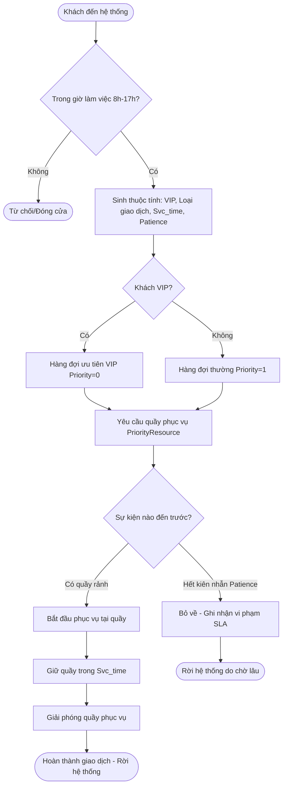

# Bản đặc tả mô hình mô phỏng sự kiện rời rạc (Tuần 1)

**Người phụ trách:** Thành viên C  
**Ngày cập nhật:** 21/10/2026  
**Dự án:** Mô phỏng hàng đợi và xác định số quầy phục vụ tối ưu  

---

## 1. Mục đích của mô hình mô phỏng

Mô hình mô phỏng sự kiện rời rạc (*Discrete-Event Simulation - DES*) bằng thư viện Python **SimPy** nhằm giải quyết các câu hỏi mà công thức giải tích thuần túy ($M/M/c$) không thể tính toán chính xác được trong môi trường vận hành thực tế:
1. **Xác định số quầy tối thiểu theo từng khung giờ** trong ngày để đáp ứng cam kết mức độ dịch vụ (SLA) với chi phí quầy-giờ thấp nhất.
2. **Khắc phục hiện tượng trễ/quán tính hàng đợi (Carry-over effect):** Số lượng khách tồn đọng từ giờ cao điểm chuyển giao sang giờ tiếp theo khi lịch quầy bị cắt giảm.
3. **Mô phỏng chính sách ưu tiên khách hàng VIP** (không ngắt quãng phục vụ) và hành vi khách hàng thiếu kiên nhẫn bỏ về (*Abandonment*).
4. **Đánh giá độ bền (Robustness/Sensitivity):** Kiểm tra xem lịch quầy tối ưu có bị vỡ trận khi nhu cầu thực tế tăng đột biến 10% – 30% hay không.

---

## 2. Cam kết mức độ dịch vụ (SLA)

Định nghĩa chính xác:
$$SL(t) = P(\text{Khách được phục vụ VÀ thời gian chờ } \le t)$$
tính trên **toàn bộ khách đến hệ thống**. Khách hàng mất kiên nhẫn bỏ về được tính là vi phạm SLA ($SL = 0$).

| Đối tượng khách hàng | Ngưỡng thời gian chờ $t$ | Mục tiêu cam kết ($SL$) | Tiêu chí đánh giá thống kê |
|---|---|---|---|
| Khách thường (`vip = 0`) | $\le 5.0$ phút | $\ge 90.0\%$ | Cận dưới khoảng tin cậy 95% ($CI_{low} \ge 90\%$) |
| Khách ưu tiên / VIP (`vip = 1`) | $\le 2.0$ phút | $\ge 90.0\%$ | Cận dưới khoảng tin cậy 95% ($CI_{low} \ge 90\%$) |

---

## 3. Sơ đồ luồng tiến trình (Process Flowchart)

---

## 4. Thực thể và trạng thái (Entities & States)

### 4.1 Thực thể tạm thời (Dynamic Entities)
- **Khách hàng (`Customer`):**
  - `id`: Mã định danh duy nhất.
  - `day`: Ngày mô phỏng (0, 1, 2, ...).
  - `t_arr`: Thời điểm khách đến (phút tính từ 8:00).
  - `hour`: Khung giờ đến ($0 \dots 8$).
  - `is_vip`: Phân loại khách hàng (1 = VIP, 0 = thường).
  - `svc_time`: Thời gian phục vụ cần thiết (phút), rút từ phân phối thực tế.
  - `patience`: Thời gian kiên nhẫn tối đa trước khi bỏ về (phút), rút từ phân phối $\text{Exp}(\theta)$.
  - `wait_time`: Thời gian thực tế phải chờ trong hàng.
  - `served`: 1 nếu được phục vụ, 0 nếu bỏ về.

### 4.2 Thực thể cố định (Permanent Resources)
- **Hệ thống quầy giao dịch (`Counters`):**
  - Quản lý bằng `simpy.PriorityResource`.
  - Sức chứa tối đa bằng số quầy cao nhất trong ngày ($c_{\max}$).
  - Điều chỉnh số quầy mở theo từng khung giờ bằng các tiến trình giữ tài nguyên ưu tiên cao nhất (`blocker process`).
- **Hàng đợi chung (`Queue`):**
  - 1 hàng đợi chung duy nhất cho toàn bộ chi nhánh.
  - Nguyên tắc xếp hàng: Ưu tiên VIP (Priority nhỏ hơn được gọi trước); trong cùng nhóm ưu tiên tuân thủ vào trước - ra trước (FIFO).

---

## 5. Các sự kiện chính trong mô phỏng (Simulation Events)

1. **`Arrival` (Khách đến):** Sinh khoảng thời gian đến tiếp theo tuân theo phân phối mũ với tham số $\lambda_h$ của khung giờ hiện tại.
2. **`Queue Entry` (Vào hàng):** Khách gửi yêu cầu cấp phát tài nguyên quầy vào `PriorityResource`.
3. **`Service Start` (Bắt đầu phục vụ):** Một quầy rảnh nhận yêu cầu, bắt đầu tính giờ phục vụ.
4. **`Service End` (Kết thúc phục vụ):** Quầy hoàn tất thao tác, giải phóng tài nguyên cho khách tiếp theo.
5. **`Abandonment` (Bỏ về):** Hết thời gian kiên nhẫn mà chưa được gọi tên, khách hủy yêu cầu và rời đi.
6. **`Shift Transition` (Chuyển đổi lịch quầy):** Đầu mỗi khung giờ $h$, tiến trình điều phối khóa hoặc mở thêm quầy. Nếu đóng bớt quầy, giao dịch viên chỉ rời đi sau khi phục vụ xong khách đang dở dang (*non-preemptive*).

---

## 6. Tham số đầu vào (Từ kết quả bàn giao của Thành viên A)

| Tham số | Ký hiệu | Giá trị thực tế | Nguồn dữ liệu |
|---|---|---|---|
| Tốc độ đến theo giờ | $\lambda_h$ | `[1.019, 1.433, 1.644, 1.439, 1.239, 1.243, 1.321, 1.305, 1.066]` | `bang_tham_so.xlsx` (`theo_gio`) |
| Thời gian phục vụ trung bình | $E[S]$ | $2.88$ phút ($\mu = 0.3475$ khách/phút) | `bang_tham_so.xlsx` (`chung`) |
| Hệ số biến thiên phục vụ | $cv$ | $1.095$ ($cs^2 = 1.20$) | `bang_tham_so.xlsx` (`chung`) |
| Phân phối phục vụ | Dist | Lognormal / Gamma ($\text{scale}=2.68, \text{shape}=1.08$) | Kiểm định phân phối |
| Tốc độ bỏ về | $\theta$ | $0.1123$ (1/phút) $\implies$ Kiên nhẫn TB = $8.91$ phút | `bang_tham_so.xlsx` (`chung`) |
| Tỉ lệ khách VIP | $p_{\text{vip}}$ | $33.85\%$ | `bang_tham_so.xlsx` (`chung`) |

---

## 7. Các giả định mô hình và cơ sở chấp nhận

1. **Tốc độ đến không đổi trong từng block 1 giờ:** Kiểm định phân tán $\chi^2$ cho thấy dòng khách trong từng giờ riêng lẻ không bác bỏ phân phối Poisson.
2. **Quầy có năng suất đồng nhất:** Các giao dịch viên có kỹ năng tương đương nhau trên cùng nghiệp vụ chuẩn `PS`.
3. **Không ngắt quãng phục vụ (Non-preemptive):** Khách VIP được ưu tiên đứng đầu hàng chờ nhưng không ngắt quãng khách thường đang ngồi tại quầy.
4. **Hệ thống mở cửa trống (Empty system at opening):** 8h00 sáng mở cửa không có khách tồn đọng từ hôm trước.

---

## 8. Điều kiện đầu, dừng và kỹ thuật thống kê

- **Điều kiện dừng (Terminating Simulation):** Mô phỏng chạy từ 8:00 (phút 0) đến 17:00 (phút 540). Sau 17:00 ngừng nhận khách mới, nhưng quầy vẫn tiếp tục phục vụ đến khi giải phóng hết khách còn tồn trong hàng.
- **Số ngẫu nhiên chung (Common Random Numbers - CRN):** Khi so sánh các chính sách lịch quầy khác nhau, cùng một dãy hạt giống số ngẫu nhiên (*random seed*) được sử dụng để giảm phương sai so sánh.
- **Số lần lặp độc lập ($N_{\text{reps}}$):**
  - Kiểm chứng lý thuyết: 30 lần lặp.
  - Tìm kiếm lịch tối ưu: 60 lần lặp.
  - Đánh giá chính sách cuối cùng và phân tích độ nhạy: 300 lần lặp.

---

## 9. Danh sách 6 thí nghiệm chuẩn bị cho Tuần 2 & 3

| Mã TN | Tên thí nghiệm | Mô tả cấu hình | Mục tiêu đo lường |
|---|---|---|---|
| **T1** | Kiểm chứng $M/M/c$ dừng | $\lambda, \mu$ cố định, phục vụ mũ, không bỏ về, không VIP | Sai lệch $W_q, L_q, \rho, SL$ so với Erlang C $< 2\%$ |
| **T2** | Kiểm chứng Erlang-A | Thêm khách bỏ về $\text{Exp}(\theta)$ | So sánh với nghiệm ma trận hấp thụ Erlang-A |
| **T3** | Đánh giá $M/G/c$ | Phục vụ Gamma/Lognormal với $cv = 0.5, 1.0, 1.2, 1.5$ | Đánh giá độ chính xác của xấp xỉ Allen-Cunneen |
| **T4** | Hàng chung vs Hàng riêng | So sánh 1 hàng chung vs $c$ hàng độc lập | Chứng minh hiệu ứng gộp hàng đợi (*pooling benefit*) |
| **T5** | Tối ưu hóa lịch quầy theo giờ | Thuật toán Heuristic 2 pha (Tăng/Giảm) trên SimPy | Tìm lịch $c_0, c_1, \dots, c_8$ đạt SLA với min quầy-giờ |
| **T6** | Phân tích độ nhạy (Stress-test) | Tăng tải $\lambda \times \{0.9, 1.0, 1.1, 1.2, 1.3\}$ | Đánh giá độ bền và đề xuất biên dự phòng an toàn |

---

## 10. Bảng ánh xạ Đặc tả ↔ Module mã nguồn dự kiến (Tuần 2)

| Khái niệm trong đặc tả | Module đảm nhiệm | Hàm / Class chính |
|---|---|---|
| Cấu trúc dữ liệu & Sinh ngẫu nhiên | `common.py` | `class Model`, `mix_service()`, `mean_ci()` |
| Đọc log & Ước lượng tham số | `a_data.py` | `load_log()`, `fit_arrivals()`, `fit_service()` |
| Công thức giải tích $M/M/c$, Erlang-A | `b_theory.py` | `mmc()`, `erlang_a()`, `sipp_schedule()` |
| Động cơ mô phỏng SimPy | `c_sim.py` | `customer_process()`, `simulate()`, `optimize_schedule()` |
| Điều phối thí nghiệm và xuất đồ thị | `main.py` | Pipeline 6 bước tổng hợp |
